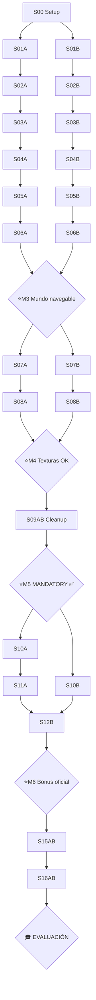

# 📅 CRONOGRAMA DE EJECUCIÓN — cub3D

> **Manual operativo** del proyecto. Plan paso a paso, con dependencias explícitas y sync points entre Persona A y Persona B.
>
> Documento complementario a [`roadmap.md`](roadmap.md):
> - **`roadmap.md`** = el **QUÉ** (arquitectura, structs, funciones, teoría).
> - **`cronograma.md`** (este) = el **CUÁNDO + ORDEN + ESTADO**.

> **Plan total:** 8 semanas · mandatory + 5 bonus oficiales del subject · 7 hitos · 6 sync points. (Mods custom — zombies/niebla/HUD — DESCARTADOS del scope: ver `CLAUDE.md`.)

---

## 🗺️ Cómo usar este documento

### Para localizarte cada día

1. Abre la **Tabla Maestra** (sección de abajo).
2. Busca el último paso que **TÚ** marcaste como `✅`.
3. Ve al detalle del **siguiente paso** asignado a tu persona (A o B).
4. Verifica los **🟦 Pre-requisitos**: si no se cumplen → vas atrás a completarlos primero.
5. Ejecuta la tarea siguiendo **📁 Archivos** y **🔧 Funciones** (con detalle en `roadmap.md`).
6. Pasa el **✅ Definition of Done** (comandos concretos para verificar).
7. Marca el paso como hecho, commit, y mira **🔓 Desbloquea** para saber qué viene.

### Convenciones de IDs

| Patrón | Significado | Ejemplo |
|---|---|---|
| `S0NA` | Paso N de Persona A | `S04A` |
| `S0NB` | Paso N de Persona B | `S04B` |
| `S0NAB` | Paso N hecho por ambos juntos | `S10AB` |
| `🔄 SYNCN` | Punto de sincronización al final de la semana N | `🔄 SYNC3` |
| `⭐ MN` | Hito mayor (milestone) | `⭐ M4` |

### Símbolos

| Símbolo | Significado |
|---|---|
| 👤 A | Solo Persona A |
| 👤 B | Solo Persona B |
| 👥 A+B | Trabajo conjunto |
| 🟦 | Pre-requisito |
| 🎯 | Objetivo |
| 📁 | Archivos |
| 🔧 | Funciones (ver roadmap) |
| ✅ | Definition of Done |
| 🔓 | Desbloquea |
| 🔄 | Sync point |
| ⭐ | Hito (milestone) |
| ☐ / ✅ | Pendiente / Hecho |

---

## 📊 Vista global: Tabla Maestra

| ID | Sem | Persona | Título | Fase roadmap | Estado |
|---|---|---|---|---|---|
| **S00** | 0 | 👥 | Setup repo, libft, MLX, Makefile base, `cub3d.h` esqueleto | — | ✅ |
| **S01A** | 1 | 👤 A | `error.c` + `enum e_output` + constantes `ERR_*` | F1 | ✅ |
| **S01B** | 1 | 👤 B | Makefile profesional (BONUS flag, `objects/`, subdirs) | F2 | ✅ |
| **S02A** | 1 | 👤 A | `parsing/check_args.c` (extension, dir, exists) | F1 | ✅ |
| **S02B** | 1 | 👤 B | `init/init_data.c` + `init/init_mlx.c` (ventana negra) | F2 | ✅ |
| **🔄 SYNC1** | 1 | 👥 | Ventana se abre, ESC cierra, parser rechaza fichero malo | — | ✅ |
| **⭐ M1** | 1 | — | **Hito: Hello world** | — | ✅ |
| **S03A** | 2 | 👤 A | `parsing/parse_data.c` + `get_file_data.c` (lee fichero, branch ID/mapa) | F1 | ✅ |
| **S03B** | 2 | 👤 B | `init/init_textures.c` (XPM → buffer int[]) + `image_utils.c` | F2 | ✅ |
| **S04A** | 2 | 👤 A | `parsing/fill_color_textures.c` (RGB con validación) | F1 | ✅ |
| **S04B** | 2 | 👤 B | `render/draw_floor_ceil.c` (suelo + techo planos) | F3 | ✅ |
| **🔄 SYNC2** | 2 | 👥 | Suelo + techo se ven, parser acepta NO/SO/WE/EA/F/C válidos | — | ✅ |
| **⭐ M2** | 2 | — | **Hito: Parser básico + render base** | — | ✅ |
| **S05A** | 3 | 👤 A | `parsing/create_game_map.c` + `change_space_into_wall` | F1 | ✅ |
| **S05B** | 3 | 👤 B | `render/raycasting.c` `init_raycasting_info` + `set_dda` + `perform_dda` | F3 | ✅ |
| **S06A** | 3 | 👤 A | `parsing/check_map.c` + `check_map_borders.c` + `check_textures.c` | F1 | ✅ |
| **S06B** | 3 | 👤 B | `render/raycasting.c` `calculate_line_height` + dibujo color plano | F3 | ✅ |
| **🔄 SYNC3** | 3 | 👥 | **Muros visibles** (color plano), parser COMPLETO con validación | — | ✅ |
| **⭐ M3** | 3 | — | **Hito: Mundo 3D navegable (sin texturas)** | — | ✅ |
| **S07A** | 4 | 👤 A | `movement/input_handler.c` + `player_dir.c` (hooks + dirección inicial=spawn) | F5 | ✅ |
| **S07B** | 4 | 👤 B | `render/texture.c` `update_texture_pixels` + shading + `tex_pixels[][]` | F4 | ✅ |
| **🔄 SYNC4** | 4 | 👥 | **Muros con texturas N/S/E/W correctas, sin espejo** | — | ✅ |
| **⭐ M4** | 4 | — | **Hito: Render final con texturas** | — | ✅ |
| **S08A** | 4-5 | 👤 A | `movement/player_move.c` + `player_pos.c` (validate_move X/Y) | F5 | ✅ |
| **S08B** | 4-5 | 👤 B | `movement/player_rotate.c` (matriz 2D) + `render/render.c` con `has_moved` | F5+F6 | ✅ |
| **🔄 SYNC5** | 5 | 👥 | **WASD + flechas + colisiones + ESC + X cierran limpio** | — | ✅ |
| **S09AB** | 5 | 👥 | `exit/exit.c` + `exit/free_data.c` + valgrind clean | F6 | ✅ |
| **⭐ M5** | 5 | — | **Hito: MANDATORY COMPLETO ✅ (defendible solo)** | — | ✅ |
| **S10A** | 5-6 | 👤 A | `bonus/minimap/minimap_render.c` + `minimap_image.c` | F7 | ✅ |
| **S10B** | 5-6 | 👤 B | `bonus/mouse/mouse_handler.c` + edge wrap | F7 | ✅ |
| **S11A** | 6 | 👤 A | `bonus/doors/*` (parse 'D' + toggle 'E' + render DDA) | F7 | ✅ |
| **S12B** | 6-7 | 👤 B | `bonus/sprites/*` — sprites animados (init/sort/project/render + z-buffer + frame cycling) | F8 | ✅ |
| **🔄 SYNC6** | 7 | 👥 | **Bonus oficial completo: minimapa + ratón + puertas + sprites animados** | — | ✅ |
| **⭐ M6** | 7 | — | **Hito: BONUS OFICIAL COMPLETO ✅** | — | ✅ |
| **S15AB** | 7-8 | 👥 | Testing exhaustivo: 30 mapas malos + 10 buenos + valgrind + asan | — | ✅ |
| **S16AB** | 8 | 👥 | Norminette 100% + README final + ensayo de defensa | — | ✅ |
| **⭐ M9** | 8 | — | **Hito: LISTO PARA EVALUACIÓN 🎓** | — | ✅ |

> **Imprime esta tabla**, marca cada paso conforme lo terminas. Es tu mapa diario.
> Leyenda extra: **🔶 = parcial** · **⬅️ AQUÍ = próximo paso**.

---

## 📌 ESTADO ACTUAL (2026-06-26) — PROYECTO COMPLETADO

**Todo vive en la rama `dev`** (origin actualizado). El proyecto está **COMPLETO**:
mandatory + los 5 bonus oficiales + mod custom de zombies (portfolio).

### ✅ MANDATORY COMPLETO (M5) — 2026-06-20
Parser + render vectorial + texturas N/S/E/W + suelo/techo + spawn + WASD/flechas +
colisiones (wall-sliding) + cleanup. Valgrind limpio, norminette 100%.

### ✅ BONUS OFICIAL COMPLETO (M6) — 2026-06-26
- **Minimap (S10A):** muros azules, jugador rojo, dos modos (full/viewport), toggle M.
- **Mouse rotation (S10B):** delta_x desde centro, recentrado, sensibilidad 0.01.
- **Puertas (S11A):** char 'D', toggle E, DDA respeta estado open/closed.
- **Sprites animados (S12B):** z-buffer, Lode projection, frame cycling, painter's sort.

### ✅ MOD CUSTOM (portfolio, no evaluado) — 2026-06-26
Zombie survival: 3 oleadas (grunt → runner → boss + fog), escopeta hitscan con animación,
HUD (HP + wave), game over/win states, BFS flow field pathfinding para enemigos,
restart con R. Compila bajo `make bonus`.

### ✅ PROYECTO LISTO PARA EVALUACIÓN (M9) — 2026-06-26
Todas las fases completadas. Repo limpio (solo ramas `dev` y `main`). Norminette y
valgrind pasan. Testing exhaustivo realizado.

---

## 🔄 PARA RODRIGO — qué tocamos de tu parte (lado B) en la integración

Tu rama `raycasting2` (motor vectorial + suelo/techo + cargador XPM) está **integrada en
`dev`**, preservando tus commits (`1e8f48d`, `d49f624`) con tu autoría. Para que encajara
con el parser y cerrar el mandatory, **completé/ajusté** esto de tu lado:

> ⬆️ **Lo último está justo encima en `dev`** (commits `9b108f2` + `eab3f04` + `ce32a1e`):
> blindaje del XPM ≠ 64×64, limpieza de la ruta de error y fixture de regresión. Haz
> `git pull` en `dev` y lo tienes.

| Fichero | Qué se hizo |
|---|---|
| `includes/cub3d.h` | Resuelto el merge: tus structs vectoriales + mis campos de `t_data`; añadidos `line_h/tex_idx/tex_x` a `t_ray`; quitados `NO/SO/WE/EA` duplicados. |
| `init/init_game.c` | Fuera `get_temp_map` y colores hardcodeados (vienen del parser). NULL-checks de MLX; devuelve `int`. **Nuevo**: si falla la carga de texturas, reporta `Error` y libera imagen+ventana (sin fuga). |
| `init/init_textures.c` | Carga desde `data->tex_paths[...]` (rutas del `.cub`), no fijas; NULL tras free. |
| `render/textures.c` | **HECHO**: guard `w==TEX_SIZE && h==TEX_SIZE` en `xpm_to_int` (XPM ≠ 64×64 → destruye imagen + `NULL`, sin OOB ni crash). |
| `render/raycasting.c` | Guard de bounds en `perform_dda` (anti-segfault); recibe `t_data`. `draw_wall_column` movido a `draw_wall.c`. |
| `render/draw_wall.c` (**NUEVO**) | **Render texturizado completo (S07B)**: cara N/S/E/W, `wall_x`, `tex_x` con inversión, shading N/E. Antes los muros eran blancos. |
| `render/game_loop.c` | `move_player(data)`. |
| `movement/player.c` | `init_player` adelgazado (spawn lo da el parser); signo de rotación corregido; **añadidas colisiones** (`is_wall`, `try_move`, wall-sliding); recibe `t_data`. |
| `exit/exit_game.c` | Añadido `free_textures`. |
| raíz | `mlx.supp` para valgrind. |
| `maps/bad/` (**NUEVO**) | `tex_wrong_size.cub` + `small_8x8.xpm`: fixture de regresión del XPM ≠ 64×64. |

**Convención de cámara (Lodev)** que usa el spawn (`check_map.c`): N dir(0,-1) plane(0.66,0)
· S dir(0,1) plane(-0.66,0) · E dir(1,0) plane(0,0.66) · W dir(-1,0) plane(0,-0.66).

**Tu siguiente trabajo parte de `dev` (NO de `raycasting2`):** ratón (S10B) + sprites (S12B).
(El XPM 64×64 ya está resuelto por nosotros — ver tabla.)

---

## 🎯 Hitos (Milestones)

Cada hito es un **estado verificable, demostrable y commiteable**. Antes de pasar al siguiente bloque de pasos, valida el hito.

### ⭐ M1 — Hello World (fin de semana 1)
- ✅ `make` compila sin warnings.
- ✅ `./cub3D` abre ventana negra de 1280×720.
- ✅ ESC y la X roja cierran limpio.
- ✅ `./cub3D fichero.txt` → `Error\nNot a .cub file`.
- ✅ `cub3d.h` tiene todos los typedefs (aunque vacíos).
- **Demo:** abrir ventana, cerrar con ESC, intentar arg malo y ver error.

### ⭐ M2 — Parser básico + render base (fin de semana 2)
- ✅ Parser acepta `.cub` con NO/SO/WE/EA/F/C válidos.
- ✅ Parser rechaza con mensaje claro: RGB > 255, falta identificador, duplicado.
- ✅ Suelo y techo se pintan con el color del `.cub`.
- ✅ Texturas XPM se cargan a `int[]` sin crash.
- **Demo:** abrir un `.cub` válido → ventana con dos colores planos (suelo + techo). Cambiar `F 220,100,0` a `F 999,100,0` → error.

### ⭐ M3 — Mundo 3D navegable sin texturas (fin de semana 3)
- ✅ Parser valida mapa (cerrado por muros, char válidos, 1 jugador).
- ✅ DDA dibuja columnas de muro con color plano.
- ✅ Sin fish-eye (paredes rectas en los lados).
- ✅ Mapa con espacios irregulares ` 1 1 1` se procesa OK.
- **Demo:** abrir `subject_map.cub` → ver muros en perspectiva 3D (color plano). Aún no hay movimiento.

### ⭐ M4 — Render final con texturas (fin de semana 4)
- ✅ Cada cara del muro (N/S/E/W) usa su textura correcta.
- ✅ No hay texturas espejo.
- ✅ Caras N/E ligeramente más oscuras (shading `>>1`).
- **Demo:** caminar mentalmente alrededor de un muro y verificar que la textura cambia entre las 4 caras.

### ⭐ M5 — MANDATORY COMPLETO (fin de semana 5)
- ✅ WASD se mueve, flechas rotan.
- ✅ Colisiones con muros (con wall sliding).
- ✅ ESC y X cierran limpio.
- ✅ `valgrind --suppressions=mlx.supp` → 0 leaks tuyos.
- ✅ `norminette sources/ includes/` → 0 errores.
- ✅ Pasa con todos los mapas en `maps/good/`.
- ✅ Aborta limpio con todos en `maps/bad/`.
- **Demo:** correr un mapa, moverse, chocar con paredes, salir limpio. Ya es defendible solo el mandatory.

### ⭐ M6 — BONUS OFICIAL COMPLETO (fin de semana 7)
- ✅ Minimapa visible (esquina inf izquierda) centrado en jugador.
- ✅ Mouse rota la cámara, edge wrap funciona.
- ✅ Puertas (`'D'` en mapa) se abren/cierran con tecla `E`.
- ✅ Sprites animados visibles con z-buffer (no aparecen detrás de muros) y ciclo de frames.
- ✅ `make bonus` compila sin warnings.
- **Demo:** abrir mapa con puertas, minimapa, sprite animado en el escenario; navegar con mouse, abrir/cerrar puertas.

### ⭐ M9 — LISTO PARA EVALUACIÓN (fin de semana 8)
- ✅ Todos los checklists del `roadmap.md` (sección Checklist Final) pasan.
- ✅ README final escrito.
- ✅ Repo limpio en GitHub (sin binarios).
- ✅ Defensa ensayada (saber explicar la parte propia y la del compañero).
- **Demo:** evaluación real con un compañero de 42 que actúe como evaluador.

---

## 📍 ¿Dónde estoy? — Self-check rápido

> Localiza tu paso actual y mira qué deberías tener listo, qué estás haciendo, y qué te queda.

| Si estás en... | ✅ Ya tienes... | 🔨 Estás haciendo... | ⏳ Aún te falta... |
|---|---|---|---|
| **S00** (Día 0) | Nada | Setup conjunto | Todo el proyecto |
| **S01A** | Repo + libft + MLX + Makefile base + `cub3d.h` esqueleto | `error.c` + enum + constantes | parser, raycasting, movimiento, bonus |
| **S01B** | Lo mismo que S01A | Makefile pro con BONUS flag | parser, init MLX, raycasting |
| **S02A** | S01A done | `check_args.c` (validación de extensión y existencia) | parsing real del fichero |
| **S02B** | S01B done | `init_data.c` + `init_mlx.c` (ventana abre) | texturas, raycasting |
| **S03A** | S02A done | Lectura de fichero a `mapinfo.file` + branching | parser de identificadores y mapa |
| **S03B** | S02B done | XPM → buffer int[] | render que use esas texturas |
| **S04A** | S03A done, identificadores parseados | Validación RGB | mapa parseado y validado |
| **S04B** | S03B done | Pintar suelo y techo planos | raycasting de muros |
| **S05A** | S04A done, identificadores OK | Construcción del grid del mapa | validación final del mapa |
| **S05B** | S04B done, suelo/techo OK | DDA básico (sin pintar nada aún) | dibujo de muros |
| **S06A** | S05A done, grid construido | Validación: bordes, chars, jugador | (mandatory parser COMPLETO al terminar) |
| **S06B** | S05B done, DDA hace map_x/y | line_height + dibujo color plano | texturas |
| **S07A** | M3 alcanzado | Hooks + dirección inicial del jugador | movimiento + colisiones |
| **S07B** | M3 alcanzado | Texturas en muros + shading | optimización render |
| **S08A** | S07A done | Movimiento + colisiones X/Y separado | (mandatory casi listo) |
| **S08B** | S07B done | Rotación + render frame loop | cleanup |
| **S09AB** | M4 alcanzado | Cleanup chain + valgrind clean | **MANDATORY COMPLETO** |
| **S10A** | M5 alcanzado | Minimapa | mouse + puertas + sprites |
| **S10B** | M5 alcanzado | Mouse + edge wrap | minimapa + puertas + sprites |
| **S11A** | S10A done | Sistema de puertas | sprites animados |
| **S12B** | S10B+S11A done | Sprites animados (infra + z-buffer + frame cycling) | testing + defensa |
| **S15AB** | M6 alcanzado | Testing exhaustivo + valgrind + asan | norminette + defensa |
| **S16AB** | S15AB done | Norminette + README + ensayo | **EVALUACIÓN** |

---

## 🔗 Mapa de dependencias



---

# 🟦 DÍA 0 — Setup conjunto

## S00 — Setup del proyecto (👥 A+B juntos · 1 día)

### 🟦 Pre-requisitos
- Linux (Ubuntu 22.04 / Debian 12 / Arch / WSL2 con WSLg) instalado.
- Cuenta GitHub con SSH key configurada.
- `gcc`, `make`, `git`, `valgrind`, `norminette`, `libx11-dev`, `libxext-dev`, `libbsd-dev` instalados.
- Editor configurado con headers 42 (extensión "42 header" en VSCode o equivalente).

### 🎯 Objetivo
Tener un repo compilable con la estructura completa, `cub3d.h` con typedefs vacíos pero correctos, primer commit en `main`, ramas `dev` y feature creadas.

### 📁 Archivos a crear
- `.gitignore` — copia de `roadmap.md` sección "Workflow de Git" → `.gitignore mínimo`.
- `Makefile` — versión mínima que solo compile un `main.c` que devuelva 0 (ampliada en S01B).
- `README.md` — placeholder con título, descripción, autores.
- `includes/cub3d.h` — esqueleto: includes + macros + typedefs según necesidad (el cronograma S00 antiguo pedía typedefs vacíos especulativos; ya está descartado por YAGNI, ver `CLAUDE.md`). Ver `roadmap.md` sección "TODAS LAS STRUCTS" para referencia.
- `includes/error_msg.h` — placeholder, vacío salvo `#ifndef`.
- `includes/colors.h` — copia del de mcombeau (códigos ANSI).
- `sources/main.c` — `int main(void) { return 0; }`.
- `libft/` — submodule o copia de tu Libft (con `get_next_line`).
- `minilibx-linux/` — submodule de `https://github.com/42Paris/minilibx-linux.git`.
- `textures/walls/` — directorio con 4 XPM de prueba (puedes copiar de `cub3D_ejemplo/textures/test/`).
- `maps/good/test_basic.cub` — un mapa mínimo válido (3×3 con un jugador).

### 🔧 Acciones (en orden)

```bash
# 1. Crear repo
mkdir cub3D && cd cub3D
git init -b main
git submodule add https://github.com/42Paris/minilibx-linux.git
# (libft: git submodule add tu-url-libft)

# 2. Crear estructura
mkdir -p includes sources/{init,parsing,render,movement,exit,debug,bonus/{minimap,mouse,doors,sprites}}
mkdir -p textures/{walls,sprites} maps/{good,bad}

# 3. Compilar MLX
make -C minilibx-linux

# 4. Crear archivos esqueleto (.gitignore, Makefile, README, headers, main.c)

# 5. Primer commit
git add .
git commit -m "init: project skeleton with MLX submodule"

# 6. Crear ramas
git checkout -b dev
git push -u origin dev
git checkout -b feature/A-fase1-error
git checkout dev
git checkout -b feature/B-fase2-makefile

# 7. Crear repo en GitHub (vía gh) y push
gh repo create cub3D --private --source=. --push
```

### ✅ Definition of Done
- [ ] `git log` muestra al menos 1 commit en `main`.
- [ ] `make` compila `main.c` sin errores ni warnings.
- [ ] `./minilibx-linux/libmlx.a` existe (MLX compilado).
- [ ] `cat includes/cub3d.h` muestra los typedefs (aunque vacíos).
- [ ] Ambos pueden hacer `git pull` desde el repo de GitHub.
- [ ] `tree -L 3 sources/ includes/` muestra la estructura completa.

### 🔓 Desbloquea
- **S01A** (Persona A puede empezar `error.c`)
- **S01B** (Persona B puede empezar Makefile profesional)

---

# 🟦 SEMANA 1 — Fundamentos en paralelo

## S01A — `error.c` + enum `e_output` + constantes `ERR_*` (👤 A · 1-2 días)

### 🟦 Pre-requisitos
- ✅ S00 done (repo + cub3d.h esqueleto).
- ✅ Branch `feature/A-fase1-error` creada.

### 🎯 Objetivo
Tener el sistema de errores centralizado funcionando para que TODO el código posterior pueda usar `err_msg(...)` y `clean_exit(...)`.

### 📁 Archivos
- `sources/error.c` — implementación.
- `includes/cub3d.h` — añadir `enum e_output { SUCCESS, FAILURE, ERR, BREAK, CONTINUE }`.
- `includes/error_msg.h` — definir todas las constantes `ERR_*` (ver lista en `roadmap.md` sección "Manejo de Errores").
- `sources/main.c` — modificar para llamar `err_msg("test", "ERR_USAGE", 1)` como prueba.

### 🔧 Funciones (ver roadmap.md → "Manejo de Errores Centralizado")
- `int err_msg(char *detail, char *str, int code)`
- `int err_msg_val(int detail, char *str, int code)`

### ✅ Definition of Done
- [ ] `make` compila sin warnings.
- [ ] `./cub3D` (sin args) imprime `cub3D: Error: Usage: usage: ./cub3d <path/to/map.cub>` en stderr (rojo si TTY).
- [ ] Exit code = 1.
- [ ] `includes/error_msg.h` tiene mínimo 25 constantes definidas.
- [ ] `norminette sources/error.c` pasa.
- [ ] Commit + push.

### 🔓 Desbloquea
- **S02A** (Persona A puede empezar `check_args.c`).

---

## S01B — Makefile profesional (👤 B · 1-2 días)

### 🟦 Pre-requisitos
- ✅ S00 done.
- ✅ Branch `feature/B-fase2-makefile` creada.

### 🎯 Objetivo
Tener el Makefile final del proyecto: compila mandatory y bonus, objects en directorio aparte, sin relinking innecesario.

### 📁 Archivos
- `Makefile` — reescritura completa según `roadmap.md` sección "Makefile Profesional".

### 🔧 Targets a implementar
- `all` — compila mandatory.
- `bonus` — re-invoca `$(MAKE) all BONUS=1`.
- `clean` — borra `objects/` + clean libft + clean mlx.
- `fclean` — `clean` + borra ejecutable + fclean libft.
- `re` — `fclean` + `all`.
- `.PHONY: all clean fclean re bonus`.

### ✅ Definition of Done
- [ ] `make` compila sin warnings (con `-Wall -Wextra -Werror`).
- [ ] `objects/` se crea con subdirs replicando `sources/`.
- [ ] Tras `make`, existe el ejecutable `cub3D`.
- [ ] `make` (segunda vez sin cambios) no recompila nada.
- [ ] `touch sources/main.c && make` recompila SOLO `main.o` y relinkea.
- [ ] `make fclean` deja el repo como antes de compilar.
- [ ] `make bonus` compila con `-DBONUS=1` (verificar con `gcc -E` si dudas).
- [ ] Commit + push.

### 🔓 Desbloquea
- **S02B** (Persona B puede empezar `init_data.c` y `init_mlx.c`).

---

## S02A — `parsing/check_args.c` (👤 A · 1 día)

### 🟦 Pre-requisitos
- ✅ S01A done (`err_msg` disponible).

### 🎯 Objetivo
Validar el argumento de la línea de comandos: existe, no es directorio, termina en `.cub`.

### 📁 Archivos
- `sources/parsing/check_args.c` — nuevo.
- `sources/main.c` — añadir llamada a `check_file(av[1], true)` antes de cualquier otra cosa.
- `includes/cub3d.h` — añadir prototipo `int check_file(char *arg, bool cub);`.

### 🔧 Funciones (ver roadmap.md → Fase 1 + sources/parsing/check_args.c)
- `static bool is_dir(char *arg)`
- `static bool is_cub_file(char *arg)`
- `static bool is_xpm_file(char *arg)` (lo usaremos para texturas en S06A)
- `int check_file(char *arg, bool cub)`

### ✅ Definition of Done
- [ ] `./cub3D foo.txt` → `Error: foo.txt: Not a .cub file`, exit 1.
- [ ] `./cub3D nonexistent.cub` → `Error: nonexistent.cub: No such file or directory`, exit 1.
- [ ] `./cub3D maps/` → `Error: maps/: Is a directory`, exit 1.
- [ ] `./cub3D maps/good/test_basic.cub` → no error (continúa, aunque el resto aún no haga nada).
- [ ] `norminette sources/parsing/check_args.c` pasa.
- [ ] Merge a `dev`.

### 🔓 Desbloquea
- **S03A** (Persona A puede empezar `parse_data.c`).

---

## S02B — `init/init_data.c` + `init/init_mlx.c` (👤 B · 1-2 días)

### 🟦 Pre-requisitos
- ✅ S01B done (Makefile pro).

### 🎯 Objetivo
Tener `init_data()` que pone todos los structs a 0/NULL, e `init_mlx()` que abre una ventana negra de 1280×720.

### 📁 Archivos
- `sources/init/init_data.c` — nuevo.
- `sources/init/init_mlx.c` — nuevo.
- `sources/main.c` — añadir `init_data(&data); init_mlx(&data); mlx_loop(data.mlx);`.
- `includes/cub3d.h` — prototipos.

### 🔧 Funciones (ver roadmap.md → Fase 2)
- `void init_data(t_data *data)` — pone todos los punteros a NULL, ints a 0.
- `static void init_mapinfo(t_mapinfo *mapinfo)` (helper).
- `static void init_player(t_player *player)` (helper).
- `void init_img_clean(t_img *img)`
- `void init_ray(t_ray *ray)`
- `void init_mlx(t_data *data)` — `mlx_init` + `mlx_new_window` 1280×720 título "Cub3D".
- `void init_img(t_data *data, t_img *image, int w, int h)`.
- `void init_texture_img(t_data *data, t_img *image, char *path)`.

### ✅ Definition of Done
- [ ] `./cub3D maps/good/test_basic.cub` abre una ventana negra de 1280×720 con título "Cub3D".
- [ ] La ventana se mantiene abierta hasta cerrar con la X.
- [ ] (ESC aún no funciona, eso es S07A.)
- [ ] No hay leaks de inicialización (verificar luego con valgrind).
- [ ] `norminette` pasa.
- [ ] Merge a `dev`.

### 🔓 Desbloquea
- **S03B** (Persona B puede empezar `init_textures.c`).

---

## 🔄 SYNC1 — Final de Semana 1 (👥 A+B juntos · 0.5 día)

### Verificaciones conjuntas
- [ ] `git pull origin dev` — ambos al día.
- [ ] `make re` compila desde cero, sin warnings.
- [ ] `./cub3D maps/good/test_basic.cub` abre ventana negra.
- [ ] `./cub3D` (sin args) imprime usage.
- [ ] `./cub3D foo.txt` imprime error.
- [ ] `./cub3D maps/` imprime error.
- [ ] No hay leaks (`valgrind ./cub3D maps/good/test_basic.cub`, dejar abrir, cerrar con X, comprobar reachable=mlx, no definite=tuyo).
- [ ] **Demostración del hito ⭐ M1**: video corto o demo cara a cara.

### Si algo falla
- Refactorizar, NO seguir adelante. Más vale 1 día extra aquí que 5 días de bugs después.

---

# 🟦 SEMANA 2 — Parser básico + render base

## S03A — `parsing/parse_data.c` + `get_file_data.c` (👤 A · 2-3 días)

### 🟦 Pre-requisitos
- ✅ S02A done.
- ✅ `get_next_line` funciona (en libft).

### 🎯 Objetivo
Leer el `.cub` entero a memoria (`t_mapinfo.file[]`) y separar identificadores de líneas de mapa con un dispatcher.

### 📁 Archivos
- `sources/parsing/parse_data.c` — nuevo.
- `sources/parsing/get_file_data.c` — nuevo.
- `sources/main.c` — añadir `parse_data(av[1], &data); get_file_data(&data, data.mapinfo.file);`.
- `includes/cub3d.h` — prototipos + completar `t_mapinfo`.

### 🔧 Funciones (ver roadmap.md → Fase 1 + sources/parsing/parse_data.c, get_file_data.c)
- `static int get_number_of_lines(char *path)`
- `static void fill_tab(int row, int column, int i, t_data *data)`
- `void parse_data(char *path, t_data *data)`
- `static char *get_texture_path(char *line, int j)`
- `static int fill_direction_textures(t_texinfo *textures, char *line, int j)`
- `static int ignore_whitespaces_get_info(t_data *data, char **map, int i, int j)`
- `int get_file_data(t_data *data, char **map)`

### ✅ Definition of Done
- [ ] `./cub3D maps/good/test_basic.cub` lee el fichero sin error.
- [ ] Si añades `printf` debug: `data.mapinfo.line_count` es correcto.
- [ ] `data.mapinfo.file[i]` contiene cada línea sin segfault.
- [ ] Texturas detectadas (NO/SO/WE/EA) → `data.texinfo.north/south/west/east` apuntan a strings válidas.
- [ ] norminette + valgrind clean.
- [ ] Merge a `dev`.

### 🔓 Desbloquea
- **S04A** (Persona A puede parsear colores).

---

## S03B — `init/init_textures.c` + `image_utils.c` (👤 B · 2 días)

### 🟦 Pre-requisitos
- ✅ S02B done.
- ✅ Texturas XPM disponibles en `textures/walls/`.

### 🎯 Objetivo
Cargar las 4 texturas XPM en arrays `int[]` accesibles por índice, y tener `set_image_pixel` listo para escribir al frame buffer.

### 📁 Archivos
- `sources/init/init_textures.c` — nuevo.
- `sources/render/image_utils.c` — nuevo.
- `includes/cub3d.h` — prototipos.

### 🔧 Funciones (ver roadmap.md → Fase 2 + sources/init/init_textures.c, render/image_utils.c)
- `static int *xpm_to_img(t_data *data, char *path)`
- `void init_textures(t_data *data)` — llama xpm_to_img para NORTH, SOUTH, EAST, WEST.
- `void init_texinfo(t_texinfo *textures)`
- `void set_image_pixel(t_img *image, int x, int y, int color)` — usando `addr[y * (size_line/4) + x] = color`.

### ✅ Definition of Done
- [ ] **Stub temporal** (mientras parser no termine): hardcodea las paths a `textures/walls/north.xpm` etc.
- [ ] `init_textures` ejecuta sin crash.
- [ ] `data.textures[NORTH][0]` (primer píxel de la textura) tiene un valor != 0 si la textura no es completamente negra.
- [ ] `set_image_pixel` escribe en una imagen MLX y se ve al volcar (testar con un cuadradito en la ventana).
- [ ] norminette + valgrind clean (cuidado: tras cargar XPM, `mlx_destroy_image(tmp)` para no leakear).
- [ ] Merge a `dev`.

### 🔓 Desbloquea
- **S04B** (Persona B puede pintar suelo y techo).

---

## S04A — `parsing/fill_color_textures.c` (👤 A · 1-2 días)

### 🟦 Pre-requisitos
- ✅ S03A done (`get_file_data` detecta líneas F y C).

### 🎯 Objetivo
Parsear correctamente las líneas `F R,G,B` y `C R,G,B` con validación 0-255.

### 📁 Archivos
- `sources/parsing/fill_color_textures.c` — nuevo.
- `includes/cub3d.h` — prototipo.

### 🔧 Funciones (ver roadmap.md → Fase 1 + sources/parsing/fill_color_textures.c)
- `static bool no_digit(char *str)`
- `static int *copy_into_rgb_array(char **rgb_to_convert, int *rgb)`
- `static int *set_rgb_colors(char *line)`
- `int fill_color_textures(t_data *data, t_texinfo *textures, char *line, int j)`

### ✅ Definition of Done
- [ ] Parser acepta `F 220,100,0` y `C 225,30,0` correctamente.
- [ ] Parser rechaza `F 999,100,0` con `Error: Invalid RGB value (min: 0, max: 255)`.
- [ ] Parser rechaza `F abc,100,0` con error.
- [ ] Parser rechaza `F 220,100` (solo 2 valores) con error.
- [ ] Parser rechaza `F 220,100,0,255` (4 valores) con error.
- [ ] Detecta duplicados: dos líneas `F` → `Error: Invalid floor RGB color` o similar.
- [ ] norminette + valgrind clean.
- [ ] Merge a `dev`.

### 🔓 Desbloquea
- **S05A** (Persona A puede construir el grid del mapa).

---

## S04B — `render/draw_floor_ceil.c` (👤 B · 1 día)

### 🟦 Pre-requisitos
- ✅ S03B done.
- ✅ Stub o real de `data.texinfo.hex_floor` / `hex_ceiling` (puede ser hardcoded por ahora).

### 🎯 Objetivo
Pintar la mitad superior de la pantalla con el color del techo y la inferior con el color del suelo. Es el "fondo" sobre el que luego se dibujan los muros.

### 📁 Archivos
- `sources/render/draw_floor_ceil.c` — nuevo.
- `sources/render/render.c` — esqueleto con `render_frame` que llame a `draw_floor_ceiling`.
- `includes/cub3d.h` — prototipos.

### 🔧 Funciones (ver roadmap.md → Fase 3)
- `void draw_floor_ceiling(t_data *data, t_img *image)` — bucle `y in [0, win_h/2)` ceiling, `y in [win_h/2, win_h)` floor.
- (Esqueleto) `void render_frame(t_data *data)` — `init_img + draw_floor_ceiling + put_image_to_window + destroy_image`.

### ✅ Definition of Done
- [ ] `./cub3D maps/good/test_basic.cub` muestra ventana con dos colores planos (techo arriba, suelo abajo).
- [ ] Cambiar valores hardcoded de `hex_floor` y `hex_ceiling` cambia los colores visibles.
- [ ] FPS > 30 (sin parpadeo).
- [ ] norminette + valgrind clean.
- [ ] Merge a `dev`.

### 🔓 Desbloquea
- **S05B** (Persona B puede empezar el DDA).

---

## 🔄 SYNC2 — Final de Semana 2 (👥 A+B juntos)

### Verificaciones conjuntas
- [ ] `make re` limpio.
- [ ] `./cub3D maps/good/test_basic.cub` abre ventana con suelo + techo coloreados (los del `.cub`).
- [ ] Parser acepta los 6 identificadores en cualquier orden.
- [ ] Parser rechaza con error claro: identificador duplicado, RGB inválido, fichero inexistente, extensión mala.
- [ ] valgrind sigue clean.
- [ ] **Demostración del hito ⭐ M2**.

---

# 🟦 SEMANA 3 — Mundo 3D navegable

## S05A — `parsing/create_game_map.c` (👤 A · 2 días)

### 🟦 Pre-requisitos
- ✅ S04A done (colores parseados).
- ✅ Identificadores ya extraídos (`get_file_data` los procesa primero).

### 🎯 Objetivo
Convertir las líneas de texto del mapa en `data->map[][]` (char **). Encontrar dimensiones (height, width). Aplicar el truco `change_space_into_wall` para evitar flood-fill.

### 📁 Archivos
- `sources/parsing/create_game_map.c` — nuevo.
- `sources/parsing/parsing_utils.c` — añadir `is_a_white_space` y `find_biggest_len`.
- `includes/cub3d.h` — prototipos.

### 🔧 Funciones (ver roadmap.md → Fase 1 + sources/parsing/create_game_map.c)
- `static int count_map_lines(t_data *data, char **file, int i)`
- `static int fill_map_tab(t_mapinfo *mapinfo, char **map_tab, int index)`
- `static int get_map_info(t_data *data, char **file, int i)`
- `static void change_space_into_wall(t_data *data)`
- `int create_map(t_data *data, char **file, int i)`

### ✅ Definition of Done
- [ ] Después de parsear, `data->map[i][j]` accesible para todo `i, j`.
- [ ] `data->mapinfo.height` y `data->mapinfo.width` correctos.
- [ ] Mapa con líneas irregulares se rellena con `\0` o `'1'` según el truco.
- [ ] Mapa con espacios `' '` interiores → se convierten en `'1'` automáticamente.
- [ ] norminette + valgrind clean.
- [ ] Merge a `dev`.

### 🔓 Desbloquea
- **S06A** (Persona A puede validar el mapa).

---

## S05B — `render/raycasting.c` init + DDA (👤 B · 2-3 días)

### 🟦 Pre-requisitos
- ✅ S04B done (suelo + techo).
- ✅ `data->map` o stub: si parser no terminó, hardcodear un mapa pequeño en `init_data` para testear.
- ✅ `data->player` con `pos_x, pos_y, dir_x, dir_y, plane_x, plane_y` (también hardcodeable).

### 🎯 Objetivo
Implementar el algoritmo DDA completo SIN dibujar nada (solo calcular `map_x`, `map_y`, detectar hit). Verificar mediante printf debug.

### 📁 Archivos
- `sources/render/raycasting.c` — nuevo.

### 🔧 Funciones (ver roadmap.md → Fase 3)
- `static void init_raycasting_info(int x, t_ray *ray, t_player *player)`
- `static void set_dda(t_ray *ray, t_player *player)`
- `static void perform_dda(t_data *data, t_ray *ray)`
- `int raycasting(t_player *player, t_data *data)` — bucle `x in [0, win_w)`, llama a las 3 anteriores. Por ahora solo printf si hit.

### ✅ Definition of Done
- [ ] `printf("col %d: hit at (%d,%d)\n", x, ray.map_x, ray.map_y);` muestra valores razonables.
- [ ] Para `x = win_w/2` (centro), el hit debe estar exactamente delante del jugador.
- [ ] Para `x = 0` (izquierda) y `x = win_w-1` (derecha), los hits están a los lados.
- [ ] No hay loops infinitos (DDA termina siempre).
- [ ] norminette pasa.
- [ ] Merge a `dev`.

### 🔓 Desbloquea
- **S06B** (Persona B puede dibujar muros).

---

## S06A — `parsing/check_map.c` + `check_map_borders.c` + `check_textures.c` (👤 A · 2-3 días)

### 🟦 Pre-requisitos
- ✅ S05A done (grid construido).

### 🎯 Objetivo
Validar que el mapa es correcto: chars válidos, exactamente 1 jugador, posición válida, mapa cerrado por muros, mapa al final del fichero, texturas existen.

### 📁 Archivos
- `sources/parsing/check_map.c` — nuevo.
- `sources/parsing/check_map_borders.c` — nuevo.
- `sources/parsing/check_textures.c` — nuevo.
- `sources/main.c` — añadir llamadas: `check_map_validity(&data, data.map)` y `check_textures_validity(&data, &data.texinfo)`.

### 🔧 Funciones (ver roadmap.md → Fase 1 + sources/parsing/check_map.c, check_map_borders.c, check_textures.c)
- `static int check_map_elements(t_data *data, char **map_tab)`
- `static int check_position_is_valid(t_data *data, char **map_tab)`
- `static int check_player_position(t_data *data, char **map_tab)`
- `static int check_map_is_at_the_end(t_mapinfo *map)`
- `int check_map_validity(t_data *data, char **map_tab)`
- `static int check_top_or_bottom(char **map_tab, int i, int j)`
- `int check_map_sides(t_mapinfo *map, char **map_tab)`
- `static int check_valid_rgb(int *rgb)`
- `static unsigned long convert_rgb_to_hex(int *rgb_tab)`
- `int check_textures_validity(t_data *data, t_texinfo *textures)`

### ✅ Definition of Done
- [ ] **Crear primero estos mapas malos** en `maps/bad/`: `wall_hole_north.cub`, `player_none.cub`, `player_multiple.cub`, `forbidden.cub` (con char `2`), `map_too_small.cub`, `textures_missing.cub`.
- [ ] Cada uno aborta con mensaje específico.
- [ ] `maps/good/test_basic.cub` y `subject_map.cub` siguen funcionando.
- [ ] `data.player.pos_x` y `pos_y` son flotantes con `+0.5` (centro de celda).
- [ ] `data.texinfo.hex_floor` y `hex_ceiling` calculados en hex desde RGB.
- [ ] norminette + valgrind clean (¡ahora hay flujos de error que liberar!).
- [ ] Merge a `dev`.

### 🔓 Desbloquea
- **(parser COMPLETO)** Todo el flujo de parser está terminado.
- **S07A** (Persona A puede empezar input handling).

---

## S06B — `render/raycasting.c` `calculate_line_height` + dibujo color plano (👤 B · 2 días)

### 🟦 Pre-requisitos
- ✅ S05B done (DDA detecta hits).

### 🎯 Objetivo
Calcular la altura de cada columna de muro y dibujarla con un color plano (sin texturas todavía). Aplicar corrección anti-fisheye.

### 📁 Archivos
- `sources/render/raycasting.c` — añadir `calculate_line_height` + dibujo.

### 🔧 Funciones (ver roadmap.md → Fase 3)
- `static void calculate_line_height(t_ray *ray, t_data *data, t_player *player)`
- En el bucle de `raycasting`: tras `calculate_line_height`, dibujar columna con `set_image_pixel` color hardcodeado (e.g. `0xFF0000` rojo).

### ✅ Definition of Done
- [ ] Ventana muestra muros 3D (todos rojos).
- [ ] Sin fisheye: las paredes a los lados son rectas, no curvas.
- [ ] Muros más lejanos son más pequeños.
- [ ] Suelo y techo siguen visibles.
- [ ] FPS > 30.
- [ ] norminette pasa.
- [ ] Merge a `dev`.

### 🔓 Desbloquea
- **S07B** (Persona B puede aplicar texturas).

---

## 🔄 SYNC3 — Final de Semana 3 (👥 A+B juntos)

### Verificaciones conjuntas
- [ ] `./cub3D maps/good/subject_map.cub` muestra **mundo 3D con muros de color plano**.
- [ ] Parser COMPLETO: rechaza todos los mapas malos creados.
- [ ] valgrind clean.
- [ ] **Demostración del hito ⭐ M3**.
- [ ] Crear mínimo 5 mapas más en `maps/bad/` (los que faltan: `color_invalid_rgb.cub`, `textures_not_xpm.cub`, etc.).

---

# 🟦 SEMANA 4 — Texturas + Movimiento

## S07A — `movement/input_handler.c` + `player_dir.c` (👤 A · 2 días)

### 🟦 Pre-requisitos
- ✅ S06A done (parser conoce `data.player.dir`).

### 🎯 Objetivo
Capturar inputs de teclado, mouse y cierre de ventana. Inicializar `dir_x/y` y `plane_x/y` según N/S/E/W del parser.

### 📁 Archivos
- `sources/movement/input_handler.c` — nuevo.
- `sources/movement/player_dir.c` — nuevo.
- `sources/main.c` — añadir `init_player_direction(&data); listen_for_input(&data);` antes de `mlx_loop`.
- `includes/cub3d.h` — prototipos. Incluir `<X11/keysym.h>`.

### 🔧 Funciones (ver roadmap.md → Fase 5 + sources/movement/input_handler.c, player_dir.c)
- `static int key_press_handler(int key, t_data *data)` — set flags `move_x/y/rotate`. ESC → `quit_cub3d`.
- `static int key_release_handler(int key, t_data *data)` — unset flags.
- `void listen_for_input(t_data *data)` — registra hooks: KeyPress, KeyRelease, ClientMessage (X), MotionNotify (BONUS).
- `static void init_player_north_south(t_player *player)`
- `static void init_player_east_west(t_player *player)`
- `void init_player_direction(t_data *data)`

### ✅ Definition of Done
- [ ] ESC cierra el programa limpio.
- [ ] X roja cierra el programa limpio.
- [ ] WASD pulsado: `data.player.move_x/y` cambia (verificar con printf).
- [ ] Flechas pulsadas: `data.player.rotate` cambia.
- [ ] Si `data.player.dir == 'N'` tras parser: `dir_y = -1, plane_x = 0.66, plane_y = 0`.
- [ ] norminette + valgrind clean (cleanup en quit_cub3d aún no, pero al menos no leak en `init`).
- [ ] Merge a `dev`.

### 🔓 Desbloquea
- **S08A** (Persona A puede empezar movimiento real).

---

## S07B — `render/texture.c` + shading (👤 B · 2-3 días)

### 🟦 Pre-requisitos
- ✅ S06B done (DDA dibuja columnas planas).
- ✅ S03B done (texturas cargadas en `data->textures[i]`).

### 🎯 Objetivo
Reemplazar el color plano por muestreo de textura según orientación N/S/E/W. Aplicar shading sutil a caras N/E con `>>1`.

### 📁 Archivos
- `sources/render/texture.c` — nuevo.
- `sources/render/raycasting.c` — modificar para llamar a `update_texture_pixels` por columna.

### 🔧 Funciones (ver roadmap.md → Fase 4 + sources/render/texture.c)
- `void init_texture_pixels(t_data *data)` — `malloc` matriz 2D `data->tex_pixels[h][w]`.
- `static void get_texture_index(t_data *data, t_ray *ray)`
- `void update_texture_pixels(t_data *data, t_texinfo *tex, t_ray *ray, int x)` — calcula tex_x, step, pos; bucle vertical pintando con muestreo.

### ✅ Definition of Done
- [ ] Muros tienen texturas correctas según N/S/E/W.
- [ ] No hay efecto espejo (verificar manualmente caminando alrededor mentalmente).
- [ ] Caras N y E ligeramente más oscuras (shading).
- [ ] FPS > 30.
- [ ] Sin parpadeo (todo en `tex_pixels` antes del volcado).
- [ ] norminette + valgrind clean.
- [ ] Merge a `dev`.

### 🔓 Desbloquea
- **S08B** (Persona B puede integrar el frame loop con `has_moved`).

---

## 🔄 SYNC4 — Mediados Semana 4 (👥 A+B juntos)

### Verificaciones conjuntas
- [ ] `./cub3D maps/good/subject_map.cub` muestra **mundo 3D con texturas en muros**, suelo + techo coloreados.
- [ ] ESC y X cierran limpio.
- [ ] Texturas N/S/E/W correctas.
- [ ] **Demostración del hito ⭐ M4**.

---

## S08A — `movement/player_move.c` + `player_pos.c` (👤 A · 2 días)

### 🟦 Pre-requisitos
- ✅ S07A done (inputs y dir inicial OK).

### 🎯 Objetivo
Mover al jugador (forward/back/strafe) con colisiones X/Y separadas para permitir wall sliding.

### 📁 Archivos
- `sources/movement/player_move.c` — nuevo.
- `sources/movement/player_pos.c` — nuevo.

### 🔧 Funciones (ver roadmap.md → Fase 5 + sources/movement/player_move.c, player_pos.c)
- `static int move_player_forward(t_data *data)` — `pos + dir * MOVESPEED`, validate.
- `static int move_player_backward(t_data *data)` — `pos - dir * MOVESPEED`.
- `static int move_player_left(t_data *data)` — strafe izq, `pos + perpendicular`.
- `static int move_player_right(t_data *data)` — strafe der.
- `int move_player(t_data *data)` — dispatch según `move_x/y/rotate`. Devuelve `moved` para `has_moved`.
- `static bool is_valid_pos_wall_collision(t_data *data, double x, double y)`
- `int validate_move(t_data *data, double new_x, double new_y)` — chequeo separado X y Y.

### ✅ Definition of Done
- [ ] W mueve adelante, S atrás (en la dirección que mira el jugador).
- [ ] A strafe izq, D strafe der (perpendicular).
- [ ] No se atraviesan muros.
- [ ] Wall sliding: rozar un muro en diagonal permite seguir avanzando paralelamente.
- [ ] norminette + valgrind clean.
- [ ] Merge a `dev`.

### 🔓 Desbloquea
- **S09AB** (cleanup global).

---

## S08B — `movement/player_rotate.c` + `render/render.c` con `has_moved` (👤 B · 2 días)

### 🟦 Pre-requisitos
- ✅ S07B done.

### 🎯 Objetivo
Rotación con flechas (matriz 2D). Frame loop oficial que solo re-renderiza si el jugador se ha movido.

### 📁 Archivos
- `sources/movement/player_rotate.c` — nuevo.
- `sources/render/render.c` — finalizar `render`, `render_frame`, `render_raycast`, `render_images`.
- `sources/main.c` — `mlx_loop_hook(data.mlx, render, &data);`.

### 🔧 Funciones (ver roadmap.md → Fase 5 + Fase 6)
- `static int rotate_left_right(t_data *data, double rotspeed)`
- `int rotate_player(t_data *data, double rotdir)`
- `static void set_frame_image_pixel(t_data *data, t_img *image, int x, int y)`
- `static void render_frame(t_data *data)`
- `static void render_raycast(t_data *data)`
- `void render_images(t_data *data)`
- `int render(t_data *data)` — `data.player.has_moved += move_player(data); if (has_moved == 0) return 0; render_images(data); return 0;`.

### ✅ Definition of Done
- [ ] Flecha izq rota cámara izq, der rota der.
- [ ] Render fluido (sin parpadeo).
- [ ] Si no pulsas nada, no se redibuja (verificar con `printf("frame!\n")` dentro de `render_images` y comprobar que solo aparece al moverse).
- [ ] FPS > 60 al moverse.
- [ ] norminette + valgrind clean.
- [ ] Merge a `dev`.

### 🔓 Desbloquea
- **S09AB** (cleanup global).

---

## 🔄 SYNC5 — Final Semana 4 / Inicio Semana 5 (👥 A+B juntos)

### Verificaciones conjuntas
- [ ] `./cub3D maps/good/subject_map.cub` permite caminar por el mapa con WASD + flechas.
- [ ] Colisiones funcionan, no atraviesa muros, hay wall sliding.
- [ ] ESC y X cierran limpio.
- [ ] Aún hay leaks (cleanup pendiente) — eso es S09AB.

---

# 🟦 SEMANA 5 — Mandatory final + Bonus oficial inicio

## S09AB — `exit/exit.c` + `exit/free_data.c` + cleanup chain (👥 A+B · 2 días)

### 🟦 Pre-requisitos
- ✅ S08A + S08B done.
- ✅ `make` mandatory completo.

### 🎯 Objetivo
Eliminar TODOS los leaks tuyos. `valgrind --suppressions=mlx.supp` debe estar limpio.

### 📁 Archivos
- `sources/exit/exit.c` — nuevo.
- `sources/exit/free_data.c` — nuevo.
- Crear `mlx.supp` (ver roadmap.md → "Protocolo de Testing").

### 🔧 Funciones (ver roadmap.md → Fase 6)
- `void clean_exit(t_data *data, int code)`
- `int quit_cub3d(t_data *data)`
- `void free_tab(void **tab)`
- `static void free_texinfo(t_texinfo *textures)`
- `static void free_map(t_data *data)`
- `int free_data(t_data *data)`

### ✅ Definition of Done
- [ ] `valgrind --leak-check=full --show-leak-kinds=all --suppressions=mlx.supp ./cub3D maps/good/subject_map.cub`, cerrar con ESC, ver:
  - `definitely lost: 0 bytes`
  - `indirectly lost: 0 bytes`
  - `possibly lost: 0 bytes` (los reachable de mlx están suppressionados)
- [ ] Lo mismo cerrando con X.
- [ ] Lo mismo en TODOS los flujos de error de mapas malos.
- [ ] norminette al 100%.
- [ ] Merge a `dev`, después merge `dev` → `main`.
- [ ] **Tag `v1.0-mandatory`** en el repo.

### 🔓 Desbloquea
- **⭐ M5: MANDATORY COMPLETO** ✅ (defendible solo).
- **S10A**, **S10B** (bonus oficial).

---

## S10A — `bonus/minimap/*` (👤 A · 2-3 días)

### 🟦 Pre-requisitos
- ✅ M5 alcanzado.
- ✅ `make bonus` compila (aunque sin minimap aún).

### 🎯 Objetivo
Renderizar un minimapa centrado en el jugador (vista parcial, no todo el mapa) en la esquina inferior izquierda.

### 📁 Archivos
- `sources/bonus/minimap/minimap_render.c` — nuevo.
- `sources/bonus/minimap/minimap_image.c` — nuevo.
- `sources/render/render.c` — añadir `if (BONUS) render_minimap(data);` después del raycast.

### 🔧 Funciones (ver roadmap.md → Fase 7 + minimap_render.c, minimap_image.c)
- `static int get_mmap_offset(t_minimap *minimap, int mapsize, int pos)`
- `static char *add_minimap_line(t_data *d, t_minimap *m, int y)`
- `static char **generate_minimap(t_data *data, t_minimap *minimap)`
- `void render_minimap(t_data *data)`
- `static void set_minimap_tile_pixels(t_minimap *minimap, int x, int y, int color)`
- `static void draw_minimap_tile(t_minimap *minimap, int x, int y)`
- `void render_minimap_image(t_data *data, t_minimap *minimap)`

### ✅ Definition of Done
- [ ] `make bonus && ./cub3D maps/good/subject_map.cub` muestra minimapa.
- [ ] Minimapa centrado en jugador (visible 9 casillas alrededor).
- [ ] Posición del jugador marcada (P verde).
- [ ] Muros gris, suelo claro, void oscuro.
- [ ] Mover jugador → minimapa actualiza.
- [ ] norminette + valgrind clean.
- [ ] Merge a `dev`.

### 🔓 Desbloquea
- **S11A** (puertas).

---

## S10B — `bonus/mouse/mouse_handler.c` (👤 B · 1-2 días)

### 🟦 Pre-requisitos
- ✅ M5 alcanzado.

### 🎯 Objetivo
Rotación de cámara con el ratón, con wrap-around al llegar a los bordes.

### 📁 Archivos
- `sources/bonus/mouse/mouse_handler.c` — nuevo.
- `sources/movement/input_handler.c` — añadir registro del hook MotionNotify si BONUS.

### 🔧 Funciones (ver roadmap.md → Fase 7 + mouse_handler.c)
- `static void wrap_mouse_position(t_data *data, int x, int y)`
- `int mouse_motion_handler(int x, int y, t_data *data)`

### ✅ Definition of Done
- [ ] Mover el ratón izq/der rota la cámara.
- [ ] Sensibilidad razonable (no gira demasiado rápido).
- [ ] Al llegar al borde de la ventana, el ratón se "teletransporta" al otro borde para poder seguir rotando.
- [ ] norminette + valgrind clean.
- [ ] Merge a `dev`.

### 🔓 Desbloquea
- **S12B** (sprites animados).

---

# 🟦 SEMANAS 6-7 — Bonus oficial completo

## S11A — `bonus/doors/*` (👤 A · 2-3 días)

### 🟦 Pre-requisitos
- ✅ S10A done.

### 🎯 Objetivo
Sistema de puertas: char `'D'` en el mapa. Tecla `E` cuando estás delante abre/cierra. DDA respeta el estado.

### 📁 Archivos
- `sources/bonus/doors/door_parse.c` — nuevo (acepta `'D'` como char válido en mapa).
- `sources/bonus/doors/door_toggle.c` — nuevo.
- `sources/bonus/doors/door_render.c` — nuevo o modificación de `raycasting.c` para tratar `'D'` cerrada como wall.
- `sources/parsing/check_map.c` — añadir `'D'` a chars válidos cuando BONUS.
- `sources/movement/input_handler.c` — tecla E llama a `toggle_door`.

### 🔧 Funciones nuevas
- `int parse_door_char(char c)` — devuelve 1 si es 'D' (open o closed).
- `void toggle_door(t_data *data)` — busca celda delante del jugador, si es 'D' cerrada → 'd' abierta, y viceversa.
- En el DDA: tratar `'D'` cerrada como muro, `'d'` abierta como suelo.

### ✅ Definition of Done
- [ ] Crear `maps/good/doors_test.cub` con varias puertas.
- [ ] Tecla E delante de puerta cerrada la abre (no más colisión, atravesable).
- [ ] Tecla E delante de puerta abierta la cierra.
- [ ] Sin puerta delante, E no hace nada.
- [ ] norminette + valgrind clean.
- [ ] Merge a `dev`.

### 🔓 Desbloquea
- **S12B** (sprites animados — último bonus oficial pendiente).

---

## S12B — `bonus/sprites/*` — Sprites animados (👤 B · 3-4 días)

> Cumple el bonus oficial **#4 "Animated sprites"** del subject (Chapter VII).

### 🟦 Pre-requisitos
- ✅ S10B done (mouse).
- ✅ S11A done (puertas) — para que el flujo de bonus oficial sea coherente.

### 🎯 Objetivo
Sistema completo de sprites animados: carga de N frames por sprite, z-buffer por columna, ordenado por distancia, proyección, render con transparencia, y ciclo de frames por temporizador para que el sprite muestre animación visible.

### 📁 Archivos
- `sources/bonus/sprites/sprite_init.c` — nuevo: carga de cada frame XPM como textura indexada.
- `sources/bonus/sprites/sprite_sort.c` — nuevo.
- `sources/bonus/sprites/sprite_project.c` — nuevo.
- `sources/bonus/sprites/sprite_render.c` — nuevo: usa el tex_id actual del sprite (frame en curso).
- `sources/bonus/sprites/sprite_anim.c` — nuevo: acumula `anim_timer` con `dt` y avanza `tex_id` cuando supera el umbral; loop modular sobre los N frames.
- `sources/render/raycasting.c` — añadir `data->z_buffer[x] = ray.wall_dist;` por columna.
- `sources/render/render.c` — añadir `if (BONUS) { tick_sprite_anim(data, dt); render_all_sprites(data); }` después del raycast.

### 🔧 Funciones (ver roadmap.md → Fase 8)
- `int init_sprite_textures(t_game *game)` — carga `N` frames por sprite (e.g. antorcha con 4 frames).
- `int init_z_buffer(t_game *game)`
- `void compute_sprite_distances(...)`
- `void sort_sprites_by_distance(...)`
- `void transform_sprite(...)`
- `int compute_screen_x(...)`
- `int compute_sprite_size(...)`
- `void render_all_sprites(t_game *game)`
- `void render_sprite(t_game *game, t_sprite *s)`
- `void draw_sprite_column(...)`
- `void tick_sprite_anim(t_game *game, double dt)` — recorre la lista, acumula `anim_timer`, avanza `frame_idx` modular sobre `frame_count`, actualiza `tex_id`.

### ✅ Definition of Done
- [ ] Crear `maps/good/sprite_test.cub` con char `'B'` (sprite genérico) para testear.
- [ ] Cargar 3-4 frames XPM en `textures/sprites/` (ej: antorcha con `torch_0..3.xpm`).
- [ ] El sprite aparece en la posición correcta del mapa.
- [ ] Caminar alrededor → siempre encarado al jugador (billboarding).
- [ ] Pasar detrás de un muro → sprite se oculta (z-buffer).
- [ ] Píxeles transparentes (negro o magenta) no se pintan.
- [ ] **Animación visible:** el sprite cicla frames de forma fluida (ej: 8-12 fps de animación, no fps del render).
- [ ] norminette + valgrind clean.
- [ ] Merge a `dev`.

### 🔓 Desbloquea
- **🔄 SYNC6** + **⭐ M6** (bonus oficial completo).

---

## 🔄 SYNC6 — Final Semana 7 (👥 A+B juntos)

### Verificaciones conjuntas
- [ ] `make bonus` compila sin warnings (con `-DBONUS=1`).
- [ ] Minimapa visible y correcto.
- [ ] Mouse rota la cámara.
- [ ] Puertas se abren/cierran con E.
- [ ] Sprites animados visibles, ciclan frames, ocultos detrás de muros (z-buffer).
- [ ] valgrind clean en `make bonus`.
- [ ] **Demostración del hito ⭐ M6**.
- [ ] **Tag `v2.0-bonus`** en el repo.

---

# 🟦 SEMANA 8 — Pulido + evaluación

## S15AB — Testing exhaustivo (👥 A+B · 2-3 días)

### 🟦 Pre-requisitos
- ✅ M6 alcanzado.

### 🎯 Objetivo
Probar TODO. Encontrar y arreglar TODOS los bugs antes de la evaluación.

### 📁 Archivos
- `maps/bad/*.cub` — completar hasta tener al menos 30 (ver `roadmap.md` → "Catálogo de Mapas de Test").
- `maps/good/*.cub` — al menos 10.
- `mlx.supp` — refinar suppressions de valgrind.
- `tests/run_all.sh` — script bash que itera mapas y verifica exit codes.

### 🔧 Acciones
1. Ejecutar `tests/run_all.sh`. Cada mapa malo debe abortar con error específico, cada bueno debe arrancar.
2. `valgrind --suppressions=mlx.supp` con cada mapa válido.
3. AddressSanitizer: `make CFLAGS="-Wall -Wextra -Werror -g3 -fsanitize=address" re && ./cub3D maps/good/*.cub`.
4. Stress test: jugar 20 minutos seguidos, vigilar `htop` por leaks crecientes.
5. Probar cerrar con ESC, X, Ctrl+C — todos limpios.
6. Probar todos los bonus oficiales: minimapa visible y centrado, mouse rota con wrap, puertas con E abren/cierran, sprite animado cicla frames y se oculta tras muros.
7. Compilar en otra distro si tienes acceso (Ubuntu / Arch / Debian).

### ✅ Definition of Done
- [ ] Script `run_all.sh` pasa al 100%.
- [ ] valgrind clean en mandatory y bonus.
- [ ] AddressSanitizer no detecta nada.
- [ ] Sin crashes en stress test 20min.
- [ ] Compila en mínimo 2 distros.
- [ ] norminette al 100%.
- [ ] Merge `dev` → `main`.
- [ ] **Tag `v4.0-final`** en el repo.

### 🔓 Desbloquea
- **S16AB** (norminette + README + ensayo).

---

## S16AB — Norminette + README + ensayo defensa (👥 A+B · 1-2 días)

### 🟦 Pre-requisitos
- ✅ S15AB done.

### 🎯 Objetivo
Pulir lo último: norma, README, y ensayar defensa con un compañero externo.

### 📁 Archivos
- `README.md` — versión final con: descripción, demo (gif si quieres), cómo compilar, controles, estructura del repo, créditos.
- (Opcional) `EVALUATION.md` — notas para los evaluadores: qué bonus implementaste, qué mods, links a recursos.

### 🔧 Acciones
1. `norminette sources/ includes/` → 0 errores. Si hay alguno, refactor (no skip).
2. Escribir/actualizar README.
3. Pedir a un compañero (no del equipo) que actúe como evaluador:
   - Que pregunte por el algoritmo de raycasting.
   - Que pregunte por el parser y los casos de error.
   - Que pregunte por el sistema de sprites animados y el z-buffer.
   - Que pregunte qué pasa si lo ejecutas con `./cub3D` sin args.
   - Que pregunte la diferencia entre KeyPress y KeyRelease en MLX.
4. Anotar las preguntas que no supiste responder bien → estudiar.

### ✅ Definition of Done
- [ ] norminette al 100%.
- [ ] README final commiteado.
- [ ] Ensayo de defensa hecho.
- [ ] Ambos saben explicar la parte del compañero (mínimo a alto nivel).
- [ ] Repo en GitHub limpio (sin binarios, sin archivos basura).

### 🔓 Desbloquea
- **⭐ M9: LISTO PARA EVALUACIÓN 🎓**.

---

# 🚨 Reglas anti-roll-back

> Cuando avances de un paso al siguiente, **NUNCA** saltes estos puntos. Si lo haces, pagarás el precio en bugs y debugging después.

1. **NO saltar el ✅ Definition of Done.** Si dice "valgrind clean", debe estar valgrind clean. Si dice "norminette pasa", debe pasar.
2. **NO saltar SYNC.** Los puntos de sync existen para detectar incompatibilidades temprano. Saltarlos = encontrar el bug 1 semana después en producción.
3. **NO mergear a `main` sin pasar por `dev`.** Mantén `main` siempre estable y demoable.
4. **NO commitear código que no compila.** Aunque sea un work-in-progress: hazlo en branch `feature/`, no en `dev`.
5. **NO modificar `cub3d.h` sin avisar al compañero.** Es archivo compartido. Coordinar antes.
6. **NO añadir features que no están en el roadmap.** Si tienes una idea, anótala para después de la evaluación.
7. **NO usar `printf` para errores.** Siempre `err_msg` (sale a stderr en rojo).
8. **NO `exit()` directo.** Siempre `clean_exit(data, code)`.
9. **NO mergear si valgrind tiene leaks tuyos.** Aunque "es solo un poco". Cero excusas.
10. **NO trabajar más de 2 días en un step sin sync con el compañero.** Si llevas 2 días atascado, pide ayuda.

---

# 🆘 "Estoy bloqueado" — FAQ

### "El programa compila pero crashea sin mensaje claro"
→ Compilar con `-fsanitize=address`. Casi siempre te dice exactamente la línea.

### "valgrind dice 'invalid read' pero no entiendo por qué"
→ Probablemente acceso fuera de array. Imprime los índices justo antes. Suele ser `i++` mal puesto o `< height` vs `<= height`.

### "El raycaster pinta todo negro / nada se ve"
→ 90% de las veces: olvidaste llamar a `init_raycasting_info` o `set_dda` antes de `perform_dda`. O `data->z_buffer` no está alocado. Comprueba con `printf("ray %d: hit (%d,%d) dist=%f\n", x, ray.map_x, ray.map_y, ray.wall_dist);`.

### "Los muros se ven curvados (efecto fish-eye)"
→ Estás usando distancia euclídea. Cambia a `perp_wall_dist = (side==0) ? sidedist_x - deltadist_x : sidedist_y - deltadist_y;`.

### "Las texturas se ven invertidas en una de las caras"
→ Falta la inversión: `if ((side == 0 && dir_x < 0) || (side == 1 && dir_y > 0)) tex_x = tex_size - tex_x - 1;`.

### "El programa no me cierra con ESC"
→ ¿Registraste el hook `KeyPress` correctamente? `mlx_hook(win, 2, 1L<<0, ...)`. Verificar con `printf` dentro del handler.

### "El programa no me cierra con la X roja"
→ Falta hook `ClientMessage`: `mlx_hook(win, 17, 0, quit_cub3d, &data)`.

### "valgrind dice que hay leak pero solo en la parte de mlx"
→ Es normal. Crea `mlx.supp` con suppressions y usa `--suppressions=mlx.supp`. Los leaks de mlx no cuentan en la evaluación de 42.

### "Cambio una textura y no se actualiza"
→ ¿Hiciste `make re`? Las texturas se cargan al iniciar, no en runtime.

### "Mi compañero modificó cub3d.h y ahora no compilo"
→ `git pull origin dev`. Lee el diff. Adapta tu código a los nuevos campos/structs. Si hay conflicto irresoluble, llama al compañero.

### "norminette se queja de algo que no entiendo"
→ Lee el mensaje exacto. Suele ser: variables no al inicio, líneas > 80 cols, tabs vs espacios. Hay extensión "42 norm" en VSCode.

### "Los sprites parpadean / aparecen detrás de muros"
→ ¿Estás llenando el `z_buffer[x]` en cada raycast? ¿Lo lees antes de pintar el sprite? Verificar con `printf("col %d zbuf=%f sprite_ty=%f\n", ...)`.

### "Tengo que cambiar entre `make` y `make bonus` y se compila raro"
→ Hacer `make fclean` antes de cambiar. Documentar en README.

---

# 📜 Apéndice: Tabla de referencia rápida (para imprimir)

| ID | Persona | Pre-req mínimo | Entregable | Test que prueba "done" |
|---|---|---|---|---|
| S00 | A+B | OS + tools | Repo, libft, MLX, Makefile base, cub3d.h esqueleto | `make` compila, `tree` muestra estructura |
| S01A | A | S00 | `error.c` + `enum e_output` + `ERR_*` | `./cub3D` (sin args) imprime usage |
| S01B | B | S00 | Makefile pro | `make bonus` compila con `-DBONUS=1` |
| S02A | A | S01A | `check_args.c` | `./cub3D foo.txt` → `Not a .cub file` |
| S02B | B | S01B | `init_data.c` + `init_mlx.c` | `./cub3D map.cub` abre ventana negra |
| 🔄1 | A+B | S02A+B | Sync semana 1 | Todo lo anterior + valgrind clean |
| ⭐M1 | — | 🔄1 | **Hello world** | Demo cara a cara |
| S03A | A | S02A | `parse_data.c` + `get_file_data.c` | Identificadores parseados a structs |
| S03B | B | S02B | `init_textures.c` + `image_utils.c` | Texturas cargadas a `int[]` |
| S04A | A | S03A | `fill_color_textures.c` | RGB válido OK, inválido rechazado |
| S04B | B | S03B | `draw_floor_ceil.c` | Suelo + techo coloreados visibles |
| 🔄2 | A+B | S04A+B | Sync semana 2 | Demo: ventana + colores + parser básico |
| ⭐M2 | — | 🔄2 | **Parser básico + render base** | |
| S05A | A | S04A | `create_game_map.c` + `change_space_into_wall` | Grid construido, dimensiones OK |
| S05B | B | S04B | `raycasting.c` DDA | Hits detectados (printf debug) |
| S06A | A | S05A | `check_map.c` + `check_map_borders.c` + `check_textures.c` | 6 mapas malos rechazados |
| S06B | B | S05B | `raycasting.c` `calculate_line_height` + draw color plano | Muros 3D color rojo visibles |
| 🔄3 | A+B | S06A+B | Sync semana 3 | Demo: muros + parser COMPLETO |
| ⭐M3 | — | 🔄3 | **Mundo 3D navegable sin texturas** | |
| S07A | A | S06A | `input_handler.c` + `player_dir.c` | ESC y X cierran limpio |
| S07B | B | S06B | `texture.c` + shading | Muros texturizados N/S/E/W |
| 🔄4 | A+B | S07A+B | Sync semana 4 | Demo: texturas correctas |
| ⭐M4 | — | 🔄4 | **Render final con texturas** | |
| S08A | A | S07A | `player_move.c` + `player_pos.c` | WASD se mueve, colisiones OK |
| S08B | B | S07B | `player_rotate.c` + `render.c` con `has_moved` | Flechas rotan, sin parpadeo |
| 🔄5 | A+B | S08A+B | Sync semana 5 | Demo: navegar mapa completo |
| S09AB | A+B | 🔄5 | `exit/exit.c` + `free_data.c` + valgrind | Cero leaks tuyos |
| ⭐M5 | — | S09AB | **MANDATORY COMPLETO ✅** | Tag v1.0-mandatory |
| S10A | A | M5 | `bonus/minimap/*` | Minimapa visible |
| S10B | B | M5 | `bonus/mouse/*` | Mouse rota cámara |
| S11A | A | S10A | `bonus/doors/*` | Tecla E abre/cierra puertas |
| S12B | B | S10B+S11A | `bonus/sprites/*` (animados, z-buffer, frame cycling) | Sprite animado visible, oculto tras muros |
| 🔄6 | A+B | S12B | Sync semana 7 | Demo: bonus oficial completo |
| ⭐M6 | — | 🔄6 | **BONUS OFICIAL COMPLETO** | Tag v2.0-bonus |
| S15AB | A+B | M6 | Testing exhaustivo + valgrind + asan | run_all.sh pasa al 100% |
| S16AB | A+B | S15AB | Norminette + README + ensayo defensa | norma 100%, ensayo hecho |
| ⭐M9 | — | S16AB | **LISTO PARA EVALUACIÓN 🎓** | Tag v4.0-final |

---

> **Si seguís este cronograma, llegaréis a la evaluación con un proyecto sólido, defendible y bien testeado. Suerte. 🚀**
