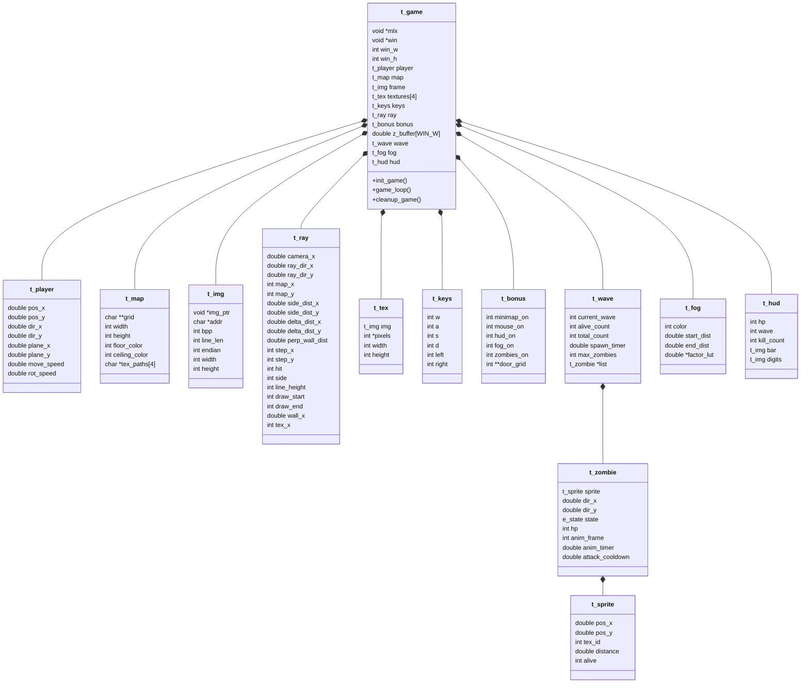

# 🗺️ ROADMAP DE IMPLEMENTACIÓN — cub3D

> Proyecto en pareja · Mandatory + Bonus + Mods avanzados (zombies + niebla + HUD) · MiniLibX · Linux nativo
> Ventana recomendada: **1280×720** (buen balance rendimiento/visual)

---

## 🎯 Cómo usar este roadmap

Este documento está diseñado para que **cualquier persona pueda construir cub3D desde cero** siguiendo el orden de las fases. Cada fase incluye:

- **Objetivo** — qué se consigue al terminar la fase.
- **Dependencias** — qué fases anteriores deben estar listas.
- **Archivos** — qué `.c` se crean/modifican.
- **Tabla de funciones** — `Función | Prototipo | Qué hace`.
- **Teoría** — fórmulas, algoritmos, diagramas.
- **Checklist** — qué verificar antes de pasar a la siguiente fase.

Las fases están numeradas y coloreadas. Las fases **Mandatory** son obligatorias (1-6). Las fases **Bonus** (7) son las que pide el subject oficial. Las fases **Mods** (8-11) son extensiones propias de este proyecto: sistema de sprites, zombies con oleadas e IA, niebla y HUD.

**Reparto sugerido:** Persona A se encarga del parsing + controles + bonus de gameplay. Persona B se encarga del motor gráfico + raycasting + sprites. Detalles al final.

---

## 🔧 Pre-requisitos y Setup del Entorno

### Software

| Requisito | Por qué | Cómo |
|---|---|---|
| **Linux** (Ubuntu/Debian/Arch/WSL2) | MiniLibX-linux usa X11; macOS/Windows nativo requieren otra MLX | Cualquier distro reciente |
| **gcc** + `make` | Compilación | `sudo apt install build-essential` |
| **X11 dev libs** | Linker MLX | `sudo apt install libx11-dev libxext-dev libbsd-dev` |
| **valgrind** | Detectar leaks | `sudo apt install valgrind` |
| **norminette** | Validar Norma 42 | `pip install norminette` |
| **git** | Versionado | `sudo apt install git` |

### Estructura inicial del repo

1. `git clone --recurse-submodules` (o añadir MiniLibX como submodule).
2. `libft/` con tu Libft + `get_next_line` (es **obligatorio** para leer el `.cub` línea a línea).
3. `mlx/` o `minilibx-linux/` (la fuente de MiniLibX, no precompilada).
4. `textures/` con `.xpm` reales para testear (usa Wolfenstein, simonkraft o tu propio set).
5. `maps/good/` y `maps/bad/` con un mínimo de 10 mapas válidos y 30 inválidos para test exhaustivo.

### Comandos críticos del día a día

```bash
make                    # Mandatory
make bonus              # Bonus + Mods (compila con -DBONUS=1)
make re                 # Recompila desde cero
make fclean             # Limpia todo

valgrind --leak-check=full --show-leak-kinds=all \
         --suppressions=mlx.supp ./cub3D maps/good/test.cub

norminette sources/ includes/   # Norma 42 al 100%
```

---

## 📜 Convenciones del Proyecto (Norma 42 + Estilo)

### Norma 42 (recordatorio resumido)

- Máximo **25 líneas por función** (sin contar firma ni llaves).
- Máximo **80 columnas por línea**.
- Máximo **5 funciones por archivo `.c`**.
- Máximo **4 parámetros por función**.
- Máximo **5 variables por función**.
- **Sin variables globales** (excepto `const` muy justificadas).
- **Sin `for`, `do-while`, `switch`, `goto`**, ni assignments en condicionales.
- Llaves K&R (línea propia para `if`, `while`, `for`).
- Cabeceras 42 en cada archivo (autogeneradas por la extensión).

### Naming

- **Tipos**: `t_*` para typedefs (`t_data`, `t_player`, `t_zombie`).
- **Estructuras anónimas**: `s_*` (`struct s_data`).
- **Enums**: `e_*` (`e_output`, `e_state`).
- **Macros**: `MAYÚSCULAS_CON_GUIONES` (`WIN_WIDTH`, `MOVE_SPEED`).
- **Funciones estáticas**: `static` siempre que solo se usen en su archivo.
- **Funciones públicas**: prefijo de módulo opcional (`render_*`, `parse_*`).

### Ownership y handoff entre módulos

- Quien hace `malloc` es responsable de documentar quién hace `free`.
- El `t_data` se inicializa una sola vez en `init_data()` y se libera una sola vez en `clean_exit()`.
- Cada submódulo tiene su par `init_*` / `free_*`.
- **Toda función que pueda fallar devuelve `int` con código del enum `e_output`** (SUCCESS=0, FAILURE=1, ERR=2…). Nunca `void` si puede haber error.

### Git workflow para pareja

| Branch | Para qué |
|---|---|
| `main` | Solo merges estables, listos para evaluar |
| `dev` | Integración de features antes de merge a `main` |
| `feature/parser-A` | Persona A trabaja aquí (parsing, controles) |
| `feature/render-B` | Persona B trabaja aquí (raycaster, sprites) |
| `feature/bonus-zombies` | Mods avanzados, una vez Mandatory esté estable |

- **Commit pequeño y atómico** (un commit por idea). Mensajes claros: `parse: validate RGB range`, no `cambios`.
- **No commitear binarios, `.o`, `cub3D`** — añadir a `.gitignore`.
- **Resolver conflictos** revisando ambos lados; si dudas, llama al compañero.

---

## 📐 Arquitectura Global — Diagrama UML Simplificado



---

## 📂 Árbol de Archivos del Proyecto

```
cub3D/
├── Makefile                      ← Targets: all clean fclean re bonus (BONUS=0/1)
├── .gitignore                    ← *.o, cub3D, objects/, *.swp
├── README.md                     ← Cómo compilar y jugar
├── roadmap.md                    ← ESTE documento
│
├── includes/
│   ├── cub3d.h                   ← Macros, enums, todos los structs, prototipos
│   ├── error_msg.h               ← Constantes ERR_* (~25 strings)
│   ├── keys.h                    ← Keycodes X11 (XK_w, XK_Escape, …) + masks
│   └── colors.h                  ← Códigos ANSI para logs + macros HEX
│
├── libft/                        ← Tu Libft completa (con get_next_line)
├── minilibx-linux/               ← MiniLibX como submodule
├── objects/                      ← Generado por make (NO commitear)
│
├── textures/
│   ├── walls/                    ← N/S/W/E walls (XPM 64×64 mínimo)
│   │   ├── north.xpm
│   │   ├── south.xpm
│   │   ├── west.xpm
│   │   └── east.xpm
│   ├── sprites/                  ← Objetos del mundo (decoración)
│   │   ├── barrel.xpm
│   │   └── lamp.xpm
│   ├── zombies/                  ← Frames de animación zombie
│   │   ├── walk_0.xpm  walk_1.xpm  walk_2.xpm  walk_3.xpm
│   │   ├── attack_0.xpm  attack_1.xpm  attack_2.xpm
│   │   └── die_0.xpm  die_1.xpm  die_2.xpm  die_3.xpm
│   └── hud/                      ← Dígitos numéricos para HUD
│       └── digits_0..9.xpm
│
├── maps/
│   ├── good/                     ← Mapas válidos (mínimo 10)
│   │   ├── subject_map.cub       ← El del subject oficial
│   │   ├── library.cub
│   │   ├── square_map.cub
│   │   ├── whitespace.cub        ← Stress-test de whitespace
│   │   └── zombies_arena.cub     ← Mapa con celdas spawn de zombies
│   └── bad/                      ← Mapas inválidos para testear errores (mínimo 30)
│       ├── empty.cub
│       ├── filetype_wrong.buc
│       ├── color_invalid_rgb.cub
│       ├── color_missing.cub
│       ├── textures_missing.cub
│       ├── textures_duplicates.cub
│       ├── textures_not_xpm.cub
│       ├── map_too_small.cub
│       ├── map_first.cub         ← Mapa antes de identificadores
│       ├── player_none.cub
│       ├── player_multiple.cub
│       ├── wall_hole_north.cub   ← Una por cada lado
│       └── …                     ← (Ver sección "Mapas de Test")
│
├── sources/
│   ├── main.c                    ← Entry point: validación, parse, init, loop
│   ├── error.c                   ← err_msg / err_msg_val
│   │
│   ├── init/
│   │   ├── init_data.c           ← Inicializa todos los structs a cero
│   │   ├── init_mlx.c            ← mlx_init + window + init_img
│   │   └── init_textures.c       ← XPM → buffer int[]
│   │
│   ├── parsing/
│   │   ├── check_args.c          ← .cub extension, dir, exists
│   │   ├── parse_data.c          ← Lee fichero entero a t_mapinfo.file
│   │   ├── get_file_data.c       ← Branching: identificador vs map vs vacío
│   │   ├── fill_color_textures.c ← Parser F/C → RGB → hex
│   │   ├── create_game_map.c     ← Convierte líneas a t_map.grid
│   │   ├── check_textures.c      ← Valida que las 4 texturas existan
│   │   ├── check_map.c           ← Validez de chars + posición jugador + final
│   │   ├── check_map_borders.c   ← Top/bottom/sides son '1' (o flood-fill)
│   │   └── parsing_utils.c       ← is_white_space, find_biggest_len
│   │
│   ├── render/
│   │   ├── render.c              ← Frame loop + skip si !has_moved
│   │   ├── raycasting.c          ← DDA completo por columna
│   │   ├── texture.c             ← update_texture_pixels + shading
│   │   ├── draw_floor_ceil.c     ← Suelo + techo (color o casting)
│   │   └── image_utils.c         ← set_image_pixel
│   │
│   ├── movement/
│   │   ├── input_handler.c       ← KeyPress/Release/Mouse/ClientMessage hooks
│   │   ├── player_dir.c          ← N/S/E/W → dir_x/y, plane_x/y
│   │   ├── player_move.c         ← forward/back/strafe lectura de flags
│   │   ├── player_pos.c          ← validate_move (X/Y separados, wall sliding)
│   │   └── player_rotate.c       ← Matriz rotación 2D
│   │
│   ├── exit/
│   │   ├── exit.c                ← clean_exit + quit_cub3d
│   │   └── free_data.c           ← free_tab + free_texinfo + free_map
│   │
│   ├── debug/
│   │   └── debug.c               ← debug_display_data (solo con DEBUG_MSG=1)
│   │
│   └── bonus/                    ← Solo se compila con BONUS=1
│       ├── minimap/
│       │   ├── minimap_render.c  ← Genera tab char alrededor del jugador
│       │   └── minimap_image.c   ← Dibuja tiles + borde
│       ├── mouse/
│       │   └── mouse_handler.c   ← Mouse motion + edge wrap
│       ├── doors/
│       │   ├── door_parse.c      ← Parser char 'D' en mapa
│       │   ├── door_toggle.c     ← Tecla E abre/cierra
│       │   └── door_render.c     ← DDA tratando 'D' como wall/floor
│       ├── sprites/
│       │   ├── sprite_init.c     ← Carga texturas + lista
│       │   ├── sprite_sort.c     ← Ordenar por distancia (lejano primero)
│       │   ├── sprite_project.c  ← Matriz inversa cámara → screen X/Y
│       │   └── sprite_render.c   ← Bucle columnas + z-buffer compare
│       ├── zombies/
│       │   ├── zombie_spawn.c    ← Crea zombie en celda Z o aleatoria
│       │   ├── zombie_wave.c     ← Lógica de oleadas (timer, dificultad)
│       │   ├── zombie_ai.c       ← State machine (idle/chase/attack/die)
│       │   ├── zombie_los.c      ← Line-of-sight raycast hasta player
│       │   ├── zombie_anim.c     ← Cicla frames según anim_timer
│       │   └── zombie_damage.c   ← Daño al jugador + cooldown
│       ├── fog/
│       │   ├── fog_init.c        ← Precomputa LUT de fog_factor
│       │   └── fog_apply.c       ← Blend de pixel con fog_color
│       └── hud/
│           ├── hud_render.c      ← HP bar + dígitos de oleada/kills
│           └── hud_digits.c      ← Blittea dígitos pre-renderizados
```

> **Nota sobre `bonus/`:** todo lo de `bonus/` se compila condicional con `#if BONUS` o se incluye en SRC solo cuando `BONUS=1`. Ver sección Makefile.

---

## 🏗️ Tarjetas CRC (Clase-Responsabilidad-Colaborador)

### t_game
| Responsabilidad | Colaboradores |
|---|---|
| Contener todo el estado del juego | Todos |
| Inicializar MLX y ventana | t_img |
| Ejecutar el game loop | t_player, t_ray, t_img |
| Liberar toda la memoria al salir | t_map, t_tex, t_img |

### t_player
| Responsabilidad | Colaboradores |
|---|---|
| Almacenar posición exacta (x,y) | t_map (colisiones) |
| Almacenar dirección de vista | t_ray (dirección del rayo) |
| Almacenar plano de cámara (FOV) | t_ray (plano de proyección) |
| Moverse y rotar | t_keys (input), t_map (colisiones) |

### t_map
| Responsabilidad | Colaboradores |
|---|---|
| Almacenar grid 2D del mapa | t_player (colisiones) |
| Almacenar colores suelo/techo | render (draw_floor_ceil) |
| Almacenar rutas de texturas | t_tex (carga) |
| Validar integridad (flood fill) | parsing |

### t_ray
| Responsabilidad | Colaboradores |
|---|---|
| Calcular dirección de cada rayo | t_player (pos + dir + plane) |
| Ejecutar DDA celda por celda | t_map (detectar muros) |
| Calcular distancia perpendicular | render (altura de línea) |
| Determinar coordenada de textura | t_tex (texX) |

### t_tex
| Responsabilidad | Colaboradores |
|---|---|
| Cargar XPM a imagen MLX | t_img (buffer de píxeles) |
| Almacenar array de colores | render (texY loop) |
| Proveer píxel por coordenada | t_ray (wallX → texX/texY) |

### t_keys
| Responsabilidad | Colaboradores |
|---|---|
| Registrar teclas pulsadas/sueltas | hooks (key_press/release) |
| Informar qué movimiento aplicar | t_player (movement/rotation) |


---

## 📋 TODAS LAS STRUCTS — Definiciones Completas

```c
/* ══════════════════════════════════════════════════════ */
/*                      cub3d.h                          */
/* ══════════════════════════════════════════════════════ */

# define WIN_W      1280
# define WIN_H      720
# define TEX_SIZE   64
# define MOVE_SPEED 0.05
# define ROT_SPEED  0.03

/* ── Imagen / Buffer ─────────────────────────────────── */
typedef struct s_img
{
    void    *img_ptr;   // Puntero devuelto por mlx_new_image
    char    *addr;      // Dirección del primer píxel (mlx_get_data_addr)
    int     bpp;        // Bits por píxel (normalmente 32)
    int     line_len;   // Bytes por línea (puede != width * 4)
    int     endian;     // 0 = little endian, 1 = big endian
    int     width;      // Ancho de la imagen en píxeles
    int     height;     // Alto de la imagen en píxeles
}   t_img;

/* ── Textura ─────────────────────────────────────────── */
typedef struct s_tex
{
    t_img   img;        // Imagen cargada del .xpm
    int     *pixels;    // Array 1D de colores (width * height)
    int     width;      // Ancho de la textura
    int     height;     // Alto de la textura
}   t_tex;

/* ── Jugador ─────────────────────────────────────────── */
typedef struct s_player
{
    char    dir;        // Dirección inicial: 'N','S','E','W' (set by parser)
    double  pos_x;      // Posición X (flotante, centro de celda → +0.5)
    double  pos_y;      // Posición Y (flotante)
    double  dir_x;      // Vector dirección X (hacia dónde mira, |dir|=1)
    double  dir_y;      // Vector dirección Y
    double  plane_x;    // Plano de cámara X (perpendicular a dir, |plane|≈0.66)
    double  plane_y;    // Plano de cámara Y (define FOV ≈ 66°)
    double  move_speed; // Velocidad de movimiento (~0.05 unidades/frame)
    double  rot_speed;  // Velocidad de rotación (~0.03 rad/frame)
    int     move_x;     // Flag input strafe: -1 izq, 0, +1 der
    int     move_y;     // Flag input walk: -1 atrás, 0, +1 adelante
    int     rotate;     // Flag input rotación: -1 izq, 0, +1 der
    int     has_moved;  // Si > 0, debe re-renderizar (perf opt)
    int     hp;         // [Mods] HP del jugador (default: 100)
    double  damage_cooldown; // [Mods] Frames hasta poder recibir daño
}   t_player;

/* ── Rayo (se recalcula por cada columna x) ──────────── */
typedef struct s_ray
{
    double  camera_x;       // Posición en plano cámara: -1 (izq) a 1 (der)
    double  ray_dir_x;      // Dirección del rayo X
    double  ray_dir_y;      // Dirección del rayo Y
    int     map_x;          // Celda actual del mapa X (entero)
    int     map_y;          // Celda actual del mapa Y (entero)
    double  side_dist_x;    // Distancia al próximo borde X
    double  side_dist_y;    // Distancia al próximo borde Y
    double  delta_dist_x;   // Distancia entre bordes X consecutivos
    double  delta_dist_y;   // Distancia entre bordes Y consecutivos
    double  perp_wall_dist; // Distancia perpendicular (anti-fisheye)
    int     step_x;         // Dirección de paso X: -1 o +1
    int     step_y;         // Dirección de paso Y: -1 o +1
    int     hit;            // ¿El rayo golpeó un muro? (0/1)
    int     side;           // ¿Qué cara? 0=vertical(E/W), 1=horizontal(N/S)
    int     line_height;    // Altura de la línea en pantalla
    int     draw_start;     // Píxel Y donde empieza la pared
    int     draw_end;       // Píxel Y donde termina la pared
    double  wall_x;         // Punto exacto de impacto (decimal 0.0-1.0)
    int     tex_x;          // Coordenada X en la textura
    int     tex_num;        // Índice de textura (0=NO,1=SO,2=WE,3=EA)
}   t_ray;

/* ── Teclas presionadas ──────────────────────────────── */
typedef struct s_keys
{
    int     w;          // Adelante
    int     a;          // Strafe izquierda
    int     s;          // Atrás
    int     d;          // Strafe derecha
    int     left;       // Rotar izquierda
    int     right;      // Rotar derecha
}   t_keys;

/* ── Mapa parseado ───────────────────────────────────── */
typedef struct s_map
{
    char    **grid;         // Mapa 2D (chars: '0','1','N','S','E','W')
    int     width;          // Ancho máximo del mapa
    int     height;         // Alto del mapa (nº de líneas)
    int     floor_color;    // Color suelo como int: (R<<16)|(G<<8)|B
    int     ceiling_color;  // Color techo como int
    char    *tex_paths[4];  // Rutas: [0]=NO, [1]=SO, [2]=WE, [3]=EA
    char    player_dir;     // Dirección inicial: 'N','S','E','W'
    int     player_x;       // Posición inicial X (entero del mapa)
    int     player_y;       // Posición inicial Y (entero del mapa)
}   t_map;

/* ── Bonus + Mods ────────────────────────────────────── */
typedef struct s_bonus
{
    int     minimap_on;     // [Bonus] ¿Mostrar minimapa?
    int     mouse_on;       // [Bonus] ¿Rotación con ratón activa?
    int     **door_grid;    // [Bonus] Grid de puertas (0=cerrada, 1=abierta)
    int     hud_on;         // [Mods] ¿Mostrar HUD (HP, oleada, kills)?
    int     fog_on;         // [Mods] ¿Aplicar niebla distance-fog?
    int     zombies_on;     // [Mods] ¿Sistema de oleadas activo?
    int     debug_on;       // ¿Mostrar overlay debug (FPS, pos, etc)?
}   t_bonus;

/* ── [Mods] Sprite genérico ──────────────────────────── */
typedef struct s_sprite
{
    double  pos_x;      // Posición en el mapa (centro)
    double  pos_y;
    int     tex_id;     // Índice de textura en data->sprite_tex[]
    double  distance;   // Cuadrado de la distancia al jugador (para sort)
    int     alive;      // 0=muerto/inactivo, 1=visible, 2=animando muerte
}   t_sprite;

/* ── [Mods] Estados del zombie ───────────────────────── */
enum e_zombie_state
{
    Z_IDLE     = 0,     // Quieto o random walk
    Z_CHASING  = 1,     // Persigue al jugador (LOS confirmada)
    Z_ATTACKING= 2,     // En rango de ataque
    Z_DYING    = 3,     // Animación de muerte (3-4 frames)
    Z_DEAD     = 4      // Sprite oculto, slot reciclable
};

/* ── [Mods] Zombie individual ────────────────────────── */
typedef struct s_zombie
{
    t_sprite    sprite;          // Posición + textura + alive
    double      dir_x;           // Dirección de movimiento (normalizada)
    double      dir_y;
    double      speed;           // Velocidad (~0.02, menor que el jugador)
    int         state;           // Ver enum e_zombie_state
    int         hp;              // HP del zombie (default: 30)
    int         anim_frame;      // Frame actual (0..N) dentro del estado
    double      anim_timer;      // Acumulador para cambiar de frame
    double      attack_cooldown; // Frames hasta poder atacar de nuevo
    double      los_check_timer; // Cooldown para no recalcular LOS cada frame
}   t_zombie;

/* ── [Mods] Sistema de oleadas ───────────────────────── */
typedef struct s_wave
{
    int         current_wave;    // Oleada actual (1, 2, 3, …)
    int         alive_count;     // Zombies vivos en esta oleada
    int         total_count;     // Zombies que se han spawneado en esta oleada
    int         max_zombies;     // Tope simultáneo (e.g. 30)
    double      spawn_timer;     // Acumulador para próximo spawn
    double      spawn_interval;  // Segundos entre spawns
    t_zombie    *list;           // Pool fijo de zombies (size = max_zombies)
    int         wave_active;     // 0 = entre oleadas, 1 = oleada en curso
    double      between_waves_t; // Cuenta atrás para próxima oleada
}   t_wave;

/* ── [Mods] Niebla (distance fog) ────────────────────── */
typedef struct s_fog
{
    int         color;           // Color de la niebla (0x808080 gris)
    double      start_dist;      // Distancia donde empieza la niebla
    double      end_dist;        // Distancia donde la niebla es total (=color)
    double      *factor_lut;     // LUT precomputada [0..end_dist*RESOLUTION]
    int         lut_size;        // Tamaño de la LUT
}   t_fog;

/* ── [Mods] HUD del juego ────────────────────────────── */
typedef struct s_hud
{
    int         hp;              // Cache del HP del jugador (para no leer cada frame)
    int         wave;            // Cache de la oleada actual
    int         kill_count;      // Total de zombies abatidos
    t_img       digits[10];      // Texturas pre-renderizadas '0'..'9'
    int         bar_width;       // Ancho de la barra de HP en píxeles
    int         bar_height;      // Alto
    int         bar_x;           // Posición X (esquina superior izq)
    int         bar_y;           // Posición Y
}   t_hud;

/* ── Estructura Principal ────────────────────────────── */
typedef struct s_game
{
    void        *mlx;            // Instancia MLX (mlx_init)
    void        *win;            // Ventana MLX
    int         win_w;           // Ancho ventana (1280)
    int         win_h;           // Alto ventana (720)
    t_player    player;          // Estado del jugador
    t_map       map;             // Mapa parseado
    t_img       frame;           // Buffer de imagen (volcado por frame)
    t_tex       textures[4];     // Texturas paredes: NO, SO, WE, EA
    int         **tex_pixels;    // Buffer 2D del frame (raycast → render)
    t_ray       ray;             // Datos del rayo actual
    t_keys      keys;            // Estado de teclas
    t_bonus     bonus;           // Flags de bonus + mods
    double      *z_buffer;       // [Mods] perp_dist por columna (sprites)
    t_tex       *sprite_tex;     // [Mods] Texturas de sprites/zombies
    int         sprite_tex_count;// [Mods] Nº de texturas de sprites cargadas
    t_wave      wave;            // [Mods] Sistema de oleadas de zombies
    t_fog       fog;             // [Mods] Datos de niebla
    t_hud       hud;             // [Mods] HUD del juego
    long        last_tick_ms;    // Timestamp del último frame (delta time)
    int         game_over;       // [Mods] 1 = HP<=0, mostrar pantalla final
}   t_game;
```


---

## 🚨 Manejo de Errores Centralizado

> **Regla de oro:** toda función que pueda fallar devuelve `int` con un código del enum `e_output`. Toda salida del programa pasa por `clean_exit()` o `free_data()`. Nunca `exit()` sin liberar.

### Enum único de retorno

```c
enum e_output
{
    SUCCESS  = 0,    // Operación correcta
    FAILURE  = 1,    // Error recuperable (continuar con cleanup)
    ERR      = 2,    // Error grave de parseo
    BREAK    = 3,    // Cortar bucle exterior
    CONTINUE = 4     // Saltar a siguiente iteración
};
```

### Constantes de mensaje (`includes/error_msg.h`)

| Categoría | Constantes |
|---|---|
| **Argumentos** | `ERR_USAGE`, `ERR_FILE_NOT_CUB`, `ERR_FILE_NOT_XPM`, `ERR_FILE_IS_DIR` |
| **Texturas** | `ERR_TEX_MISSING`, `ERR_TEX_INVALID`, `ERR_TEX_RGB_VAL`, `ERR_TEX_DUPLICATE` |
| **Colores** | `ERR_COLOR_FLOOR`, `ERR_COLOR_CEILING`, `ERR_COLOR_MISSING`, `ERR_FLOOR_CEILING` |
| **Mapa** | `ERR_INVALID_MAP`, `ERR_INV_LETTER`, `ERR_NUM_PLAYER`, `ERR_PLAYER_DIR`, `ERR_PLAYER_POS`, `ERR_MAP_MISSING`, `ERR_MAP_TOO_SMALL`, `ERR_MAP_NO_WALLS`, `ERR_MAP_LAST` |
| **Sistema** | `ERR_MALLOC`, `ERR_MLX_START`, `ERR_MLX_WIN`, `ERR_MLX_IMG` |
| **[Mods]** | `ERR_SPRITE_LIMIT`, `ERR_ZOMBIE_TEX_MISSING`, `ERR_FOG_PARAM` |

### API de logging

| Función | Prototipo | Qué hace |
|---|---|---|
| `err_msg` | `int err_msg(char *detail, char *str, int code)` | Imprime `cub3D: Error: <detail>: <str>` en stderr (con color rojo si TTY). Devuelve `code` para encadenar `return (err_msg(...))`. |
| `err_msg_val` | `int err_msg_val(int detail, char *str, int code)` | Variante con `int` como detalle (e.g. valor RGB inválido). |

### Patrón de uso obligatorio

| Situación | Patrón |
|---|---|
| Validación con código | `if (cond_falla) return (err_msg(path, ERR_X, FAILURE));` |
| Malloc fallido | `if (!ptr) clean_exit(data, err_msg(NULL, ERR_MALLOC, 1));` |
| Error fatal MLX | `if (!data->win) clean_exit(data, err_msg("mlx", ERR_MLX_WIN, 1));` |
| Cierre limpio del usuario | `clean_exit(data, 0);` |

> **Nunca** `exit()` directo. **Nunca** `printf` para errores (va a stderr). **Nunca** `perror` directo (usa `strerror(errno)` dentro de `err_msg`).

---

## 🔨 Makefile Profesional

> Sustituye al Makefile mínimo que tienes ahora. Soporta compilación condicional `mandatory` vs `bonus`, objects en directorio aparte con subdirs, dependencias correctas y limpieza completa.

### Targets obligatorios (Norma 42)

| Target | Qué hace |
|---|---|
| `make` / `make all` | Compila la versión Mandatory (BONUS=0) |
| `make bonus` | Compila la versión Bonus + Mods (BONUS=1, define `-DBONUS=1`) |
| `make clean` | Borra `objects/`, llama a clean de libft y mlx |
| `make fclean` | `clean` + borra ejecutable + fclean libft |
| `make re` | `fclean` + `all` |

### Estructura recomendada

| Variable | Valor / Significado |
|---|---|
| `NAME` | `cub3D` |
| `CC` | `gcc` o `cc` |
| `CFLAGS` | `-Wall -Wextra -Werror` (obligatorio) + `-g3` para debug + `-MMD -MP` para deps |
| `BONUS` | `0` por defecto, `1` cuando `make bonus`. Pasado al preprocesador con `-DBONUS=$(BONUS)` |
| `MLX_PATH` | `minilibx-linux/` |
| `MLX_LIB` | `$(MLX_PATH)libmlx.a` |
| `LIBFT_PATH` | `libft/` |
| `LIBFT_LIB` | `$(LIBFT_PATH)libft.a` |
| `INC` | `-I includes/ -I $(LIBFT_PATH) -I $(MLX_PATH)` |
| `LDFLAGS` | `-L$(MLX_PATH) -lmlx -L$(LIBFT_PATH) -lft -lXext -lX11 -lm` |
| `OBJ_PATH` | `objects/` (con subdirs replicando `sources/`) |

### Listado de fuentes

Separar el `SRC` en dos variables:
- `SRC_MANDATORY` — fuentes que van siempre (`main.c`, `error.c`, `init/*`, `parsing/*`, `render/*` core, `movement/*`, `exit/*`, `debug/*`).
- `SRC_BONUS` — fuentes solo en bonus (`bonus/minimap/*`, `bonus/mouse/*`, `bonus/doors/*`, `bonus/sprites/*`, `bonus/zombies/*`, `bonus/fog/*`, `bonus/hud/*`).

Selección condicional:
```makefile
ifeq ($(BONUS), 1)
    SRC = $(SRC_MANDATORY) $(SRC_BONUS)
else
    SRC = $(SRC_MANDATORY)
endif
```

### Regla del target `bonus`

```makefile
bonus:
	@$(MAKE) all BONUS=1
```

Esto re-invoca `make` con `BONUS=1`. Los `.o` se compilan con `-DBONUS=1`, así que cualquier `#if BONUS` en el código se activa.

### Reglas de objects + subdirectorios

```makefile
$(OBJ_PATH):
	@mkdir -p $(OBJ_PATH)/init
	@mkdir -p $(OBJ_PATH)/parsing
	@mkdir -p $(OBJ_PATH)/render
	@mkdir -p $(OBJ_PATH)/movement
	@mkdir -p $(OBJ_PATH)/exit
	@mkdir -p $(OBJ_PATH)/debug
	@mkdir -p $(OBJ_PATH)/bonus/minimap
	@mkdir -p $(OBJ_PATH)/bonus/mouse
	@mkdir -p $(OBJ_PATH)/bonus/doors
	@mkdir -p $(OBJ_PATH)/bonus/sprites
	@mkdir -p $(OBJ_PATH)/bonus/zombies
	@mkdir -p $(OBJ_PATH)/bonus/fog
	@mkdir -p $(OBJ_PATH)/bonus/hud

$(OBJ_PATH)%.o: $(SRC_PATH)%.c
	$(CC) $(CFLAGS) -DBONUS=$(BONUS) -c $< -o $@ $(INC)
```

### Pre-requisito: `.PHONY`

```makefile
.PHONY: all clean fclean re bonus
```

> **Pitfall:** sin `.PHONY`, si existe un fichero llamado `clean` o `bonus` en el repo, `make clean` no se ejecutaría.

### Detección de switch mandatory ↔ bonus

Para evitar mezclar objects de un modo con otro, se puede tocar un fichero marcador:

```makefile
$(NAME): $(OBJS) | check_bonus_consistency
check_bonus_consistency:
	@[ -f .bonus_built ] && [ "$(BONUS)" = "0" ] && $(MAKE) fclean || true
	@[ ! -f .bonus_built ] && [ "$(BONUS)" = "1" ] && $(MAKE) fclean || true
	@touch .bonus_built_$(BONUS)
```

> Más simple: documenta en README "haz `make fclean` antes de cambiar entre `make` y `make bonus`".

---

# ═══════════════════════════════════════════════════════
# FASES DE IMPLEMENTACIÓN
# ═══════════════════════════════════════════════════════

## 🔵 FASE 1 — Fundamentos y Parsing (👤 Persona A)

> **Objetivo:** Leer el .cub, validar todo, y tener t_game + t_map listos.
> **Dependencias:** Libft con get_next_line.
> **Archivos:** `main.c`, `parsing/*.c`, `utils/error.c`

### 📁 `main.c` — Entry Point

| Función | Prototipo | Qué hace |
|---|---|---|
| `main` | `int main(int argc, char **argv)` | Valida que argc==2 y extensión es `.cub`. Llama a `parse_file`, `init_game`, `setup_hooks`, `mlx_loop`. |
| `check_extension` | `int check_extension(char *file, char *ext)` | Comprueba que el fichero termina en `.cub`. Devuelve 1 si OK, 0 si no. |

### 📁 `parsing/parse_file.c` — Lectura del archivo

| Función | Prototipo | Qué hace |
|---|---|---|
| `parse_file` | `void parse_file(char *path, t_game *game)` | Abre el fichero, lee línea a línea con GNL. Separa identificadores del mapa. Valida que todos los 6 identificadores estén presentes. |
| `process_line` | `int process_line(char *line, t_game *game)` | Analiza una línea: si empieza por NO/SO/WE/EA/F/C la envía a `parse_identifier`. Si contiene chars de mapa, la envía a `parse_map_line`. |

### 📁 `parsing/parse_identifiers.c` — Texturas y colores

| Función | Prototipo | Qué hace |
|---|---|---|
| `parse_identifier` | `void parse_identifier(char *line, t_game *game)` | Detecta el tipo (NO/SO/WE/EA/F/C) y delega al parser correcto. Detecta duplicados. |
| `parse_texture` | `void parse_texture(char *line, int index, t_game *game)` | Extrae la ruta del .xpm, valida que el archivo exista con `open()`. Guarda en `map.tex_paths[index]`. |

### 📁 `parsing/parse_colors.c` — RGB a entero

| Función | Prototipo | Qué hace |
|---|---|---|
| `parse_color` | `int parse_color(char *line)` | Extrae R,G,B de la cadena "220,100,0". Valida rango 0-255. Devuelve `(R << 16) \| (G << 8) \| B`. |
| `validate_rgb` | `int validate_rgb(int r, int g, int b)` | Comprueba que cada valor esté en [0, 255]. |

### 📁 `parsing/parse_map.c` — Extracción del mapa

| Función | Prototipo | Qué hace |
|---|---|---|
| `parse_map` | `void parse_map(char **lines, t_game *game)` | Convierte las líneas de texto en `map.grid` (char **). Calcula `width` y `height`. Encuentra la posición del jugador (N/S/E/W). |
| `find_player` | `void find_player(t_game *game)` | Recorre el grid buscando N/S/E/W. Guarda posición y dirección en `map.player_x/y/dir`. Error si hay 0 o >1 jugadores. |

### 📁 `parsing/validate_map.c` — Flood Fill

| Función | Prototipo | Qué hace |
|---|---|---|
| `validate_map` | `void validate_map(t_game *game)` | Crea copia del mapa, lanza flood_fill desde la posición del jugador. Si el fill toca bordes o espacios sin cerrar → Error. |
| `flood_fill` | `void flood_fill(char **grid, int x, int y, t_map *map)` | Algoritmo recursivo/iterativo. Marca casillas visitadas como 'V'. Si sale de límites o toca ' ' sin muro → mapa inválido. |
| `check_chars` | `int check_chars(char c)` | Valida que el carácter sea uno de: '0','1','N','S','E','W',' '. |

### 📁 `parsing/parse_utils.c` — Utilidades

| Función | Prototipo | Qué hace |
|---|---|---|
| `skip_spaces` | `char *skip_spaces(char *str)` | Avanza el puntero saltando espacios y tabs. |
| `is_empty_line` | `int is_empty_line(char *line)` | Devuelve 1 si la línea solo tiene whitespace o está vacía. |
| `ft_arrlen` | `int ft_arrlen(char **arr)` | Cuenta elementos de un array de strings. |

### 📁 `utils/error.c` — Gestión de errores

| Función | Prototipo | Qué hace |
|---|---|---|
| `error_exit` | `void error_exit(char *msg, t_game *game)` | Imprime "Error\n" + msg en stderr. Llama a `cleanup_game`. Hace `exit(1)`. |
| `error_msg` | `void error_msg(char *msg)` | Solo imprime "Error\n" + msg en stderr sin salir. |

### 🧠 Teoría Fase 1

**Parsing del .cub:**
- Leer con `get_next_line` línea a línea
- Los identificadores (NO/SO/WE/EA/F/C) pueden venir en cualquier orden
- El mapa SIEMPRE es lo último del fichero
- Los espacios en el mapa son válidos pero deben estar "encerrados"

**Flood Fill:**
- Se parte de la posición del jugador
- Se expande en 4 direcciones (arriba, abajo, izq, der)
- Si llega al borde del array o a un espacio ' ' que no tiene muro al lado → INVÁLIDO
- Alternativa: recorrer bordes del mapa y comprobar que todo borde sea '1' o ' '

**Conversión RGB → int:**
```
color = (R << 16) | (G << 8) | B
Ejemplo: R=220, G=100, B=0 → 0x00DC6400
```


---

## 🟢 FASE 2 — Inicialización y Motor Gráfico Base (👤 Persona B)

> **Objetivo:** Inicializar MLX, ventana, cargar texturas, crear el buffer de imagen.
> **Dependencias:** Ninguna (se puede hacer en paralelo con Fase 1).
> **Archivos:** `init/*.c`, `render/textures.c`, `utils/pixel_put.c`

### 📁 `init/init_game.c` — Inicialización de MLX

| Función | Prototipo | Qué hace |
|---|---|---|
| `init_game` | `void init_game(t_game *game)` | Llama a `mlx_init()`, `mlx_new_window()`. Inicializa `frame` con `mlx_new_image()`. Carga texturas. Inicializa `keys` a 0. |
| `init_frame` | `void init_frame(t_game *game)` | Crea la imagen buffer con `mlx_new_image(mlx, WIN_W, WIN_H)`. Obtiene `addr` con `mlx_get_data_addr()`. |

### 📁 `init/init_player.c` — Posición y vectores del jugador

| Función | Prototipo | Qué hace |
|---|---|---|
| `init_player` | `void init_player(t_game *game)` | Según `map.player_dir` (N/S/E/W), asigna `dir_x/y` y `plane_x/y`. Posición = `player_x + 0.5`, `player_y + 0.5` (centro de celda). |
| `set_dir_north` | `void set_dir_north(t_player *p)` | `dir=(0,-1)`, `plane=(0.66,0)` → Mira arriba, FOV ~66°. |
| `set_dir_south` | `void set_dir_south(t_player *p)` | `dir=(0,1)`, `plane=(-0.66,0)`. |
| `set_dir_east` | `void set_dir_east(t_player *p)` | `dir=(1,0)`, `plane=(0,0.66)`. |
| `set_dir_west` | `void set_dir_west(t_player *p)` | `dir=(-1,0)`, `plane=(0,-0.66)`. |

### 📁 `render/textures.c` — Carga de texturas XPM

| Función | Prototipo | Qué hace |
|---|---|---|
| `load_textures` | `void load_textures(t_game *game)` | Para cada ruta `tex_paths[i]`, llama a `load_single_texture`. Error si alguna falla. |
| `load_single_texture` | `void load_single_texture(t_game *game, t_tex *tex, char *path)` | Usa `mlx_xpm_file_to_image()` para cargar. Extrae `addr` con `mlx_get_data_addr()`. Copia los píxeles a `tex->pixels` (array int). |
| `extract_tex_pixels` | `void extract_tex_pixels(t_tex *tex)` | Lee `addr` de la imagen MLX y copia cada píxel (int) al array `tex->pixels[y * width + x]` para acceso rápido. |

### 📁 `utils/pixel_put.c` — Escritura optimizada de píxeles

| Función | Prototipo | Qué hace |
|---|---|---|
| `my_mlx_pixel_put` | `void my_mlx_pixel_put(t_img *img, int x, int y, int color)` | Calcula offset: `addr + (y * line_len + x * (bpp / 8))`. Escribe el color directamente en memoria. |

### 🧠 Teoría Fase 2

**¿Por qué no usar mlx_pixel_put?**
- `mlx_pixel_put` repinta la ventana en CADA llamada → extremadamente lento
- En su lugar: escribir todos los píxeles en un buffer (`t_img`)
- Al final del frame: `mlx_put_image_to_window()` → vuelca todo de golpe

**Fórmula de my_mlx_pixel_put:**
```
offset = y * line_length + x * (bits_per_pixel / 8)
*(unsigned int *)(addr + offset) = color
```
`line_length` puede ser mayor que `width * 4` por alineación de memoria.

**Vectores iniciales del jugador:**
- `dir` = hacia dónde mira (longitud ~1.0)
- `plane` = perpendicular a dir (longitud ~0.66 → FOV ≈ 66°)
- FOV = 2 × atan(0.66 / 1.0) ≈ 66°
- `dir` y `plane` SIEMPRE deben ser perpendiculares entre sí

**Carga de texturas:**
- `mlx_xpm_file_to_image(mlx, path, &w, &h)` → devuelve `void *img`
- `mlx_get_data_addr(img, &bpp, &line_len, &endian)` → dirección de píxeles
- Copiar a int[] para acceso indexado: `pixels[y * w + x]`

---

## 🟡 FASE 3 — Motor de Raycasting (👤 Persona B)

> **Objetivo:** Implementar el algoritmo DDA completo y renderizar paredes con colores planos.
> **Dependencias:** Fase 2 completada.
> **Archivos:** `render/raycasting.c`, `render/render.c`, `render/draw_floor_ceil.c`

### 📁 `render/render.c` — Bucle principal de render

| Función | Prototipo | Qué hace |
|---|---|---|
| `render_frame` | `void render_frame(t_game *game)` | Limpia el frame. Dibuja suelo/techo. Para cada columna x (0 a WIN_W-1): calcula rayo, ejecuta DDA, dibuja columna. Vuelca frame a ventana. |

### 📁 `render/draw_floor_ceil.c` — Suelo y techo

| Función | Prototipo | Qué hace |
|---|---|---|
| `draw_floor_ceiling` | `void draw_floor_ceiling(t_game *game)` | Mitad superior de pantalla (y=0 a WIN_H/2) → color techo. Mitad inferior (y=WIN_H/2 a WIN_H) → color suelo. Usa `my_mlx_pixel_put`. |

### 📁 `render/raycasting.c` — Algoritmo DDA

| Función | Prototipo | Qué hace |
|---|---|---|
| `cast_single_ray` | `void cast_single_ray(t_game *game, int x)` | Para la columna x: calcula camera_x, ray_dir, inicia DDA, encuentra muro, calcula perpWallDist, lineHeight, drawStart/End. |
| `init_ray` | `void init_ray(t_game *game, int x)` | Calcula `camera_x = 2*x/(double)WIN_W - 1`. `ray_dir = dir + plane * camera_x`. `map_x/y = (int)pos`. `delta_dist = fabs(1/ray_dir)`. |
| `init_step` | `void init_step(t_game *game)` | Según signo de ray_dir: asigna step (-1/+1) y sideDist inicial. |
| `perform_dda` | `void perform_dda(t_game *game)` | Bucle while(!hit): avanza al siguiente borde (X o Y según sideDist menor), comprueba si grid[mapY][mapX] == '1'. |
| `calc_wall_height` | `void calc_wall_height(t_game *game)` | Calcula `perpWallDist`. `lineHeight = WIN_H / perpWallDist`. Clampea drawStart (≥0) y drawEnd (<WIN_H). |

### 🧠 Teoría Fase 3

**Algoritmo DDA paso a paso:**

1. **cameraX** = posición en plano cámara: `2 * x / (double)w - 1`
   - x=0 → cameraX=-1 (izquierda), x=w/2 → 0 (centro), x=w-1 → 1 (derecha)

2. **rayDir** = dirección del rayo:
   ```
   rayDirX = dirX + planeX * cameraX
   rayDirY = dirY + planeY * cameraX
   ```

3. **deltaDist** = distancia entre cruces de grid:
   ```
   deltaDistX = fabs(1.0 / rayDirX)  (si rayDirX==0 → 1e30)
   deltaDistY = fabs(1.0 / rayDirY)
   ```

4. **step + sideDist** = dirección y distancia inicial:
   ```
   Si rayDirX < 0: stepX = -1, sideDistX = (posX - mapX) * deltaDistX
   Si rayDirX > 0: stepX = +1, sideDistX = (mapX + 1.0 - posX) * deltaDistX
   ```

5. **Bucle DDA:**
   ```
   while (!hit):
     Si sideDistX < sideDistY:
       sideDistX += deltaDistX, mapX += stepX, side = 0
     Sino:
       sideDistY += deltaDistY, mapY += stepY, side = 1
     Si grid[mapY][mapX] == '1': hit = 1
   ```

6. **perpWallDist** (anti-fisheye):
   ```
   Si side == 0: perpWallDist = sideDistX - deltaDistX
   Si side == 1: perpWallDist = sideDistY - deltaDistY
   ```

7. **Altura de línea:**
   ```
   lineHeight = (int)(WIN_H / perpWallDist)
   drawStart = max(0, -lineHeight/2 + WIN_H/2)
   drawEnd = min(WIN_H - 1, lineHeight/2 + WIN_H/2)
   ```


---

## 🟠 FASE 4 — Texturas en Paredes (👤 Persona B)

> **Objetivo:** Aplicar las texturas .xpm a las paredes según su orientación N/S/E/W.
> **Dependencias:** Fase 3 completada + texturas cargadas (Fase 2).
> **Archivos:** `render/draw_walls.c` (nuevo), modificar `render/raycasting.c`

### 📁 `render/draw_walls.c` — Dibujar columnas texturizadas

| Función | Prototipo | Qué hace |
|---|---|---|
| `draw_wall_column` | `void draw_wall_column(t_game *game, int x)` | Selecciona textura según `ray.side` y dirección del rayo. Calcula wallX, texX. Bucle vertical (drawStart → drawEnd): calcula texY, lee color de `tex.pixels[]`, dibuja con `my_mlx_pixel_put`. |
| `get_tex_index` | `int get_tex_index(t_ray *ray)` | Devuelve 0(NO), 1(SO), 2(WE) o 3(EA) según `side` y signo de `ray_dir`. |
| `calc_wall_x` | `double calc_wall_x(t_game *game)` | Si side==0: `wallX = posY + perpWallDist * rayDirY`. Si side==1: `wallX = posX + perpWallDist * rayDirX`. `wallX -= floor(wallX)`. |
| `calc_tex_x` | `int calc_tex_x(t_game *game, double wall_x)` | `texX = (int)(wallX * texWidth)`. Invierte si mira a la derecha (side0+rayDirX>0) o arriba (side1+rayDirY<0). |

### 🧠 Teoría Fase 4

**Selección de textura por orientación:**
```
side == 0 (pared vertical):
  rayDirX < 0 → textura WE (oeste, miramos hacia la izquierda)
  rayDirX > 0 → textura EA (este, miramos hacia la derecha)
side == 1 (pared horizontal):
  rayDirY < 0 → textura NO (norte, miramos hacia arriba)
  rayDirY > 0 → textura SO (sur, miramos hacia abajo)
```

**wallX — Punto exacto de impacto:**
```
Si side == 0: wallX = posY + perpWallDist * rayDirY
Si side == 1: wallX = posX + perpWallDist * rayDirX
wallX -= floor(wallX)   // Solo la parte decimal (0.0 a 1.0)
```

**texX — Columna de la textura:**
```
texX = (int)(wallX * texWidth)
// Invertir según dirección para evitar texturas espejo:
if (side==0 && rayDirX > 0) texX = texWidth - texX - 1
if (side==1 && rayDirY < 0) texX = texWidth - texX - 1
```

**Bucle vertical texY:**
```
step = texHeight / lineHeight           // Cuánto avanzar en textura por píxel
texPos = (drawStart - WIN_H/2 + lineHeight/2) * step  // Inicio

for y = drawStart to drawEnd:
    texY = (int)texPos & (texHeight - 1)  // Máscara rápida (potencia de 2)
    texPos += step
    color = tex.pixels[texY * texWidth + texX]
    my_mlx_pixel_put(&frame, x, y, color)
```

---

## 🔴 FASE 5 — Controles y Movimiento (👤 Persona A)

> **Objetivo:** WASD para moverse, flechas para rotar, ESC para salir, cierre de ventana.
> **Dependencias:** Fase 1 completada (parsing listo para colisiones con mapa).
> **Archivos:** `hooks/*.c`, `player/*.c`

### 📁 `hooks/key_hooks.c` — Gestión de teclas

| Función | Prototipo | Qué hace |
|---|---|---|
| `key_press` | `int key_press(int keycode, t_game *game)` | Marca la tecla como pulsada en `game->keys`. Si ESC → `cleanup_game` + `exit(0)`. |
| `key_release` | `int key_release(int keycode, t_game *game)` | Desmarca la tecla en `game->keys`. |

### 📁 `hooks/window_hooks.c` — Cierre de ventana

| Función | Prototipo | Qué hace |
|---|---|---|
| `close_window` | `int close_window(t_game *game)` | Llamada al pulsar X de la ventana. Llama a `cleanup_game` + `exit(0)`. |
| `setup_hooks` | `void setup_hooks(t_game *game)` | Registra `mlx_hook(win, 2, 1L<<0, key_press)` (KeyPress). `mlx_hook(win, 3, 1L<<1, key_release)` (KeyRelease). `mlx_hook(win, 17, 0, close_window)` (DestroyNotify). `mlx_loop_hook(mlx, game_loop, game)`. |

### 📁 `player/movement.c` — Walk y Strafe

| Función | Prototipo | Qué hace |
|---|---|---|
| `move_player` | `void move_player(t_game *game)` | Lee `game->keys`. Si W/S: `move_forward/backward`. Si A/D: `strafe_left/right`. |
| `move_forward` | `void move_forward(t_game *game)` | Nueva posición = `pos + dir * moveSpeed`. Comprueba colisión en X e Y por separado antes de mover. |
| `move_backward` | `void move_backward(t_game *game)` | Nueva posición = `pos - dir * moveSpeed`. Misma lógica de colisión. |
| `strafe_left` | `void strafe_left(t_game *game)` | Mueve perpendicular a dir: `pos -= plane * moveSpeed`. Colisión separada X/Y. |
| `strafe_right` | `void strafe_right(t_game *game)` | Mueve perpendicular a dir: `pos += plane * moveSpeed`. Colisión separada X/Y. |
| `is_walkable` | `int is_walkable(t_game *game, double x, double y)` | Comprueba que `grid[(int)y][(int)x] == '0'` (o posición jugador). Devuelve 1 si se puede pisar. |

### 📁 `player/rotation.c` — Rotación de cámara

| Función | Prototipo | Qué hace |
|---|---|---|
| `rotate_player` | `void rotate_player(t_game *game)` | Si `keys.left`: `rotate(-rotSpeed)`. Si `keys.right`: `rotate(+rotSpeed)`. |
| `rotate` | `void rotate(t_player *p, double angle)` | Aplica matriz de rotación 2D a `dir` y `plane` simultáneamente. |

### 🧠 Teoría Fase 5

**Keycodes X11 Linux:**
```
W = 119,  A = 97,   S = 115,  D = 100
← = 65361,  → = 65363
ESC = 65307
```

**Sistema de teclas simultáneas:**
- Usar key_press para marcar `keys.w = 1` y key_release para `keys.w = 0`
- En el game_loop, leer el estado de TODAS las teclas → permite pulsar W+D a la vez

**Colisiones separadas en X e Y:**
```
// Esto permite "wall hugging" (deslizarse por la pared)
if (is_walkable(game, posX + dirX * speed, posY))
    posX += dirX * speed;
if (is_walkable(game, posX, posY + dirY * speed))
    posY += dirY * speed;
```

**Matriz de rotación 2D:**
```
oldDirX = dirX
dirX = dirX * cos(angle) - dirY * sin(angle)
dirY = oldDirX * sin(angle) + dirY * cos(angle)

oldPlaneX = planeX
planeX = planeX * cos(angle) - planeY * sin(angle)
planeY = oldPlaneX * sin(angle) + planeY * cos(angle)
```
⚠️ Guardar `oldDirX` y `oldPlaneX` ANTES de modificar, porque se usan en la segunda línea.

---

## 🟣 FASE 6 — Game Loop + Integración + Cleanup (👤 Ambos)

> **Objetivo:** Unir todo, crear el bucle principal, gestionar memoria.
> **Dependencias:** Fases 1-5 completadas.
> **Archivos:** `main.c` (ampliar), `utils/cleanup.c`

### Función del Game Loop (en `main.c` o archivo dedicado)

| Función | Prototipo | Qué hace |
|---|---|---|
| `game_loop` | `int game_loop(t_game *game)` | 1) `move_player`. 2) `rotate_player`. 3) `render_frame`. 4) `mlx_put_image_to_window`. Devuelve 0 (requerido por MLX). |

### 📁 `utils/cleanup.c` — Liberación de memoria

| Función | Prototipo | Qué hace |
|---|---|---|
| `cleanup_game` | `void cleanup_game(t_game *game)` | Libera todo en orden: texturas → frame → mapa → ventana → display. |
| `free_map` | `void free_map(t_map *map)` | Libera cada línea de `grid` con `free`, luego `free(grid)`. Libera `tex_paths[i]`. |
| `free_textures` | `void free_textures(t_game *game)` | Para cada textura: `mlx_destroy_image(mlx, tex.img.img_ptr)`. `free(tex.pixels)`. |
| `free_mlx` | `void free_mlx(t_game *game)` | `mlx_destroy_image(mlx, frame.img_ptr)`. `mlx_destroy_window(mlx, win)`. `mlx_destroy_display(mlx)`. `free(mlx)`. |

### 🧠 Teoría Fase 6

**Orden de cleanup (IMPORTANTE):**
1. Destruir imágenes de texturas (`mlx_destroy_image`)
2. Liberar arrays de píxeles de texturas (`free`)
3. Destruir imagen del frame (`mlx_destroy_image`)
4. Liberar mapa (`free` cada línea + el array)
5. Destruir ventana (`mlx_destroy_window`)
6. Destruir display (`mlx_destroy_display`)
7. Liberar puntero MLX (`free`)

**Verificar con Valgrind:**
```bash
valgrind --leak-check=full --show-leak-kinds=all ./cub3D maps/test.cub
```


---

## ⭐ FASE 7 — BONUS (👤 Ambos)

> **Objetivo:** Añadir features extra. Solo si la parte obligatoria es PERFECTA.
> **Archivos:** `bonus/*.c`

### 📁 `bonus/minimap_bonus.c` — Minimapa 2D (👤 Persona A)

| Función | Prototipo | Qué hace |
|---|---|---|
| `draw_minimap` | `void draw_minimap(t_game *game)` | Dibuja una versión reducida del mapa en la esquina superior izquierda. Escala cada celda a un cuadrado de ~8x8 píxeles. |
| `draw_minimap_tile` | `void draw_minimap_tile(t_game *game, int mx, int my, int color)` | Dibuja un cuadrado de NxN píxeles en la posición del minimapa. |
| `draw_minimap_player` | `void draw_minimap_player(t_game *game)` | Dibuja un punto para la posición del jugador + línea de dirección. |

**Teoría:** Recorrer `grid[y][x]`. Si '1' → cuadrado gris. Si '0' → cuadrado negro. Posición del jugador como punto rojo. Centrar el minimapa alrededor del jugador (solo mostrar ~15x15 celdas).

### 📁 `bonus/mouse_bonus.c` — Rotación con ratón (👤 Persona B)

| Función | Prototipo | Qué hace |
|---|---|---|
| `mouse_move` | `int mouse_move(int x, int y, t_game *game)` | Calcula diferencia entre posición actual del ratón y centro de pantalla. Rota la cámara proporcionalmente a esa diferencia. Recentra el ratón con `mlx_mouse_move`. |
| `setup_mouse` | `void setup_mouse(t_game *game)` | Registra `mlx_hook(win, MotionNotify, PointerMotionMask, mouse_move)`. Oculta cursor si es posible. |

**Teoría:** `delta_x = mouse_x - WIN_W/2`. `angle = delta_x * sensibilidad`. Aplicar `rotate(player, angle)`. Recentrar ratón a `(WIN_W/2, WIN_H/2)`.

### 📁 `bonus/doors_bonus.c` — Puertas (👤 Persona A)

| Función | Prototipo | Qué hace |
|---|---|---|
| `toggle_door` | `void toggle_door(t_game *game)` | Al pulsar 'E': busca la celda frente al jugador. Si es puerta cerrada → abre. Si abierta → cierra. |
| `is_door` | `int is_door(t_game *game, int x, int y)` | Comprueba si `grid[y][x] == 'D'` (puerta). |

**Teoría:** Añadir 'D' como char válido en el parser. En el DDA, tratar 'D' cerrada como muro y 'D' abierta como espacio. Al abrir, cambiar temporalmente a '0'. Al cerrar, volver a 'D'.

---

## 🟤 FASE 8 — Sistema de Sprites + Z-buffer (👤 Persona B)

> **Objetivo:** dibujar objetos del mundo (decoraciones primero, luego zombies) usando el algoritmo de sprites de Lode con un z-buffer por columna.
> **Dependencias:** Fases 3 + 4 completadas (raycasting con texturas).
> **Archivos:** `bonus/sprites/sprite_init.c`, `sprite_sort.c`, `sprite_project.c`, `sprite_render.c`. Modificar `render/raycasting.c` para llenar el `z_buffer`.
> **Pre-requisito conceptual:** un sprite es una imagen que se dibuja "billboarded" (siempre mirando al jugador). No tiene profundidad propia; es 2D en el espacio 3D.

### 📁 `bonus/sprites/sprite_init.c` — Carga e inicialización

| Función | Prototipo | Qué hace |
|---|---|---|
| `init_sprite_textures` | `int init_sprite_textures(t_game *game)` | Carga todas las texturas de sprites desde `textures/sprites/` y `textures/zombies/`. Las guarda en `game->sprite_tex[]`. |
| `init_z_buffer` | `int init_z_buffer(t_game *game)` | `malloc` `double[win_w]`. Se rellena cada frame durante el raycast de paredes. |
| `add_sprite_from_map` | `int add_sprite_from_map(t_game *game, char c, int x, int y)` | Llamada por el parser cuando encuentra un char de sprite (`Z`, `B`, etc.). Lo añade a la lista correspondiente. |

### 📁 `bonus/sprites/sprite_sort.c` — Ordenado por distancia

| Función | Prototipo | Qué hace |
|---|---|---|
| `compute_sprite_distances` | `void compute_sprite_distances(t_game *game, t_sprite *list, int n)` | Para cada sprite: `distance = (px-sx)^2 + (py-sy)^2`. **No** usar `sqrt` (innecesario para sort). |
| `sort_sprites_by_distance` | `void sort_sprites_by_distance(t_sprite *list, int n)` | Ordena descendente (lejos primero, painter's algorithm). Usar insertion sort (n pequeño, suele ≤30 sprites). |

### 📁 `bonus/sprites/sprite_project.c` — Proyección a pantalla

| Función | Prototipo | Qué hace |
|---|---|---|
| `transform_sprite` | `void transform_sprite(t_game *game, t_sprite *s, double *tx, double *ty)` | Aplica matriz inversa de cámara: `inv_det = 1/(plane_x*dir_y - dir_x*plane_y)`; `tx = inv_det*(dir_y*sx - dir_x*sy)`; `ty = inv_det*(-plane_y*sx + plane_x*sy)`. `sx, sy` son `sprite.pos - player.pos`. |
| `compute_screen_x` | `int compute_screen_x(t_game *game, double tx, double ty)` | `screen_x = (win_w/2) * (1 + tx/ty)`. Coordenada horizontal del centro del sprite. |
| `compute_sprite_size` | `int compute_sprite_size(t_game *game, double ty)` | `size = abs(win_h / ty)`. Cuanto más cerca (ty pequeño), más grande. |

### 📁 `bonus/sprites/sprite_render.c` — Renderizado por columna

| Función | Prototipo | Qué hace |
|---|---|---|
| `render_all_sprites` | `void render_all_sprites(t_game *game)` | Itera sprites ordenados; para cada uno llama a `render_sprite`. |
| `render_sprite` | `void render_sprite(t_game *game, t_sprite *s)` | Calcula transform + screen_x + size + draw_start_y/end_y. Bucle de columnas (`x`) entre `[screen_x - size/2, screen_x + size/2]`. Para cada columna, comprueba: `ty > 0` (delante del jugador) y `ty < z_buffer[x]` (más cerca que la pared en esa columna). Si pasa, dibuja la columna del sprite con muestreo de textura. |
| `draw_sprite_column` | `void draw_sprite_column(t_game *game, t_sprite *s, int x, int size, int draw_start_y, int draw_end_y, double ty)` | Bucle vertical desde `draw_start_y` hasta `draw_end_y`. Calcula `tex_y` con la misma fórmula que las paredes. Lee píxel de la textura de sprite. **Píxeles transparentes** (color 0 o magenta `0xFF00FF`) se saltan. |

### 🧠 Teoría Fase 8

**¿Por qué un z-buffer por columna y no por píxel?**
En cub3D las paredes son siempre verticales en pantalla → la profundidad es constante por columna. Almacenar 1 valor por columna (no por píxel) ahorra `win_w * win_h * sizeof(double)` → solo `win_w * sizeof(double)`. Es la clave de que el raycaster sea rápido.

**Llenado del z-buffer:**
Se rellena en `render/raycasting.c` justo cuando se calcula `perp_wall_dist`:
```
z_buffer[x] = ray.perp_wall_dist;
```
Se debe hacer ANTES de que se rendericen los sprites (los sprites lo leen).

**Algoritmo de proyección de sprite (Lode part 3):**
1. Posición relativa: `sx = sprite.x - player.x; sy = sprite.y - player.y`.
2. Determinante inverso: `inv = 1 / (plane_x*dir_y - dir_x*plane_y)`.
3. Transformación: `tx = inv * (dir_y*sx - dir_x*sy)`; `ty = inv * (-plane_y*sx + plane_x*sy)`.
4. `screen_x = (win_w/2) * (1 + tx/ty)`.
5. `size = abs(win_h / ty)`. Misma fórmula que `line_height` de paredes.
6. `draw_start_y = -size/2 + win_h/2`; `draw_end_y = size/2 + win_h/2`. Clampear a `[0, win_h-1]`.
7. `draw_start_x = -size/2 + screen_x`; `draw_end_x = size/2 + screen_x`. Clampear a `[0, win_w-1]`.
8. Para cada columna `x` en ese rango: si `ty > 0 && ty < z_buffer[x]`, dibujar.
9. `tex_x = (int)(256 * (x - (-size/2 + screen_x)) * tex_w / size) / 256`.
10. Para cada `y` en `[draw_start_y, draw_end_y]`: `d = (y * 256 - win_h * 128 + size * 128)`; `tex_y = ((d * tex_h) / size) / 256`.

**Píxeles transparentes:**
Los XPM no soportan transparencia per se. Convención: el color `0x000000` (negro puro) o `0xFF00FF` (magenta) se trata como transparente. En el bucle, si `color == TRANSPARENT_COLOR`, no escribir píxel.

**Painter's algorithm:**
Pintar de lejos a cerca evita necesitar comparación profunda píxel a píxel. Para sprites superpuestos esto es suficiente. Si dos sprites están casi a la misma distancia, el último pintado gana.

### ✅ Checklist Fase 8

- [ ] `z_buffer[]` se rellena correctamente en cada raycast de pared.
- [ ] Un sprite estático (e.g. barril) se dibuja en la posición correcta.
- [ ] El sprite se oculta detrás de paredes que están más cerca.
- [ ] Sprites más lejanos se dibujan más pequeños.
- [ ] Píxeles transparentes (negro) no se pintan, se ven el muro/suelo detrás.
- [ ] Múltiples sprites (≥3) se renderizan sin parpadeo y en orden correcto.
- [ ] Mover el jugador alrededor del sprite muestra el "billboarding" (siempre encarado).

---

## ⚫ FASE 9 — Zombies con IA y Oleadas (👤 Persona A + B)

> **Objetivo:** spawnear zombies por oleadas, que persigan al jugador con line-of-sight, ataquen al estar en rango, mueran al recibir disparos (o al impactar), y reciclen sus slots para la siguiente oleada.
> **Dependencias:** Fase 8 (sprites + z-buffer) completada. Movimiento del jugador OK.
> **Archivos:** `bonus/zombies/zombie_spawn.c`, `zombie_wave.c`, `zombie_ai.c`, `zombie_los.c`, `zombie_anim.c`, `zombie_damage.c`. Modificar parser para reconocer celdas de spawn `'Z'`.

### 📁 `bonus/zombies/zombie_spawn.c` — Generación de zombies

| Función | Prototipo | Qué hace |
|---|---|---|
| `init_wave` | `int init_wave(t_game *game, int max_zombies)` | `malloc` pool fijo de `t_zombie[max_zombies]`. Inicializa `wave.list[i].state = Z_DEAD` para todos. |
| `spawn_zombie_at` | `int spawn_zombie_at(t_game *game, double x, double y)` | Busca primer slot con `state == Z_DEAD`. Lo activa: `state = Z_IDLE`, `pos = (x+0.5, y+0.5)`, `hp = 30`, frame = 0. Devuelve índice o -1 si no hay slots. |
| `spawn_zombie_random` | `int spawn_zombie_random(t_game *game)` | Elige una celda `'Z'` del mapa que NO esté en línea de vista del jugador. Llama a `spawn_zombie_at`. |
| `find_spawn_cells` | `int find_spawn_cells(t_game *game)` | Recorre el mapa al inicio, lista todas las celdas marcadas `'Z'` (que se convierten luego a `'0'`). Almacena en `game->wave.spawn_cells[]`. |

### 📁 `bonus/zombies/zombie_wave.c` — Lógica de oleadas

| Función | Prototipo | Qué hace |
|---|---|---|
| `update_wave` | `void update_wave(t_game *game, double dt)` | Tick principal. Si `wave_active` y `total_count < max_for_this_wave`, decrementa `spawn_timer`. Si llega a 0: spawn + reset timer. Si `alive_count == 0 && total_count == max`: termina oleada, inicia `between_waves_t`. |
| `next_wave` | `void next_wave(t_game *game)` | Incrementa `current_wave`. Recalcula dificultad: `max_for_this_wave = 5 + 2*current_wave`; `spawn_interval *= 0.9`; HP zombies aumenta `+5*current_wave`. |
| `start_between_waves` | `void start_between_waves(t_game *game)` | Pone `wave_active = 0`, arranca cuenta atrás `between_waves_t = 5.0` (segundos). |
| `tick_between_waves` | `void tick_between_waves(t_game *game, double dt)` | Decrementa `between_waves_t`. Cuando llega a 0, llama a `next_wave` y reactiva. |

### 📁 `bonus/zombies/zombie_ai.c` — State machine

| Función | Prototipo | Qué hace |
|---|---|---|
| `update_zombies` | `void update_zombies(t_game *game, double dt)` | Itera todos los zombies vivos. Para cada uno llama a `update_zombie_ai`. |
| `update_zombie_ai` | `void update_zombie_ai(t_game *game, t_zombie *z, double dt)` | Switch sobre `z->state`. Cada estado tiene su lógica (ver tabla abajo). |
| `transition_state` | `void transition_state(t_zombie *z, int new_state)` | Cambia `state`, resetea `anim_frame=0`, `anim_timer=0`. |
| `move_zombie_toward_player` | `void move_zombie_toward_player(t_game *game, t_zombie *z, double dt)` | Calcula vector unitario hacia el jugador. Aplica colisión separada en X/Y (igual que el jugador). Si colisiona en ambos ejes, intenta movimiento perpendicular (steering simple). |

### Estados y transiciones

| Estado | Comportamiento | Transición a |
|---|---|---|
| `Z_IDLE` | Random walk lento (cambia dirección cada N segundos). | `Z_CHASING` si LOS al jugador. |
| `Z_CHASING` | Mueve hacia el jugador. Recalcula LOS cada `los_check_timer` (e.g. 0.3s). | `Z_ATTACKING` si distancia < `ATTACK_RANGE`. `Z_IDLE` si pierde LOS por > N segundos. |
| `Z_ATTACKING` | Detiene movimiento. Anima ataque. Aplica daño en frame específico. Cooldown. | `Z_CHASING` si jugador se aleja. `Z_DYING` si muere. |
| `Z_DYING` | Anima muerte (3-4 frames). Sin colisión. | `Z_DEAD` cuando termina la animación. |
| `Z_DEAD` | Slot reciclable, sprite oculto, no se actualiza. | (ninguna) Reusable por `spawn_zombie_at`. |

### 📁 `bonus/zombies/zombie_los.c` — Line of Sight

| Función | Prototipo | Qué hace |
|---|---|---|
| `has_line_of_sight` | `int has_line_of_sight(t_game *game, double x1, double y1, double x2, double y2)` | DDA simplificado desde `(x1,y1)` hasta `(x2,y2)`. Devuelve 1 si NO golpea pared antes de llegar al destino. Reutiliza el algoritmo del raycaster de paredes pero con bound = distancia objetivo. |
| `distance_squared` | `double distance_squared(double x1, double y1, double x2, double y2)` | `(x1-x2)^2 + (y1-y2)^2`. Para evitar `sqrt`. |

### 📁 `bonus/zombies/zombie_anim.c` — Animación

| Función | Prototipo | Qué hace |
|---|---|---|
| `tick_zombie_anim` | `void tick_zombie_anim(t_zombie *z, double dt)` | `anim_timer += dt`. Si supera `FRAME_DURATION` (e.g. 0.15s), incrementa `anim_frame` y resetea timer. Si llega al final del ciclo, vuelve a 0 (loop) o transiciona a otro estado (e.g. `Z_DYING` → `Z_DEAD`). |
| `get_zombie_tex_id` | `int get_zombie_tex_id(t_zombie *z)` | Devuelve el índice de textura en `game->sprite_tex[]` según `state` y `anim_frame`. Tabla: `Z_IDLE/CHASING` usa `walk_0..3`, `Z_ATTACKING` usa `attack_0..2`, `Z_DYING` usa `die_0..3`. |

### 📁 `bonus/zombies/zombie_damage.c` — Daño y combate

| Función | Prototipo | Qué hace |
|---|---|---|
| `apply_zombie_attack` | `void apply_zombie_attack(t_game *game, t_zombie *z)` | Si `z->attack_cooldown <= 0` y dist < `ATTACK_RANGE`: `player.hp -= 10`, `z->attack_cooldown = 1.0` (segundos). Sonido o flash de pantalla opcional. |
| `kill_zombie` | `void kill_zombie(t_zombie *z, t_wave *wave)` | `z->state = Z_DYING`, `wave->alive_count--`, `wave->kill_count++`. |
| `check_player_death` | `void check_player_death(t_game *game)` | Si `player.hp <= 0`: `game->game_over = 1`. Mostrar pantalla final + esperar input para salir. |

### Macros sugeridas (en `cub3d.h`)

| Macro | Valor | Significado |
|---|---|---|
| `ZOMBIE_HP_BASE` | `30` | HP inicial de un zombie en oleada 1 |
| `ZOMBIE_SPEED` | `0.02` | Unidades/frame (más lento que jugador) |
| `ZOMBIE_ATTACK_RANGE` | `0.7` | Distancia mínima para atacar |
| `ZOMBIE_ATTACK_DAMAGE` | `10` | HP que quita por golpe |
| `ZOMBIE_ATTACK_COOLDOWN` | `1.0` | Segundos entre ataques |
| `WAVE_FIRST_SIZE` | `5` | Zombies en oleada 1 |
| `WAVE_GROWTH` | `2` | +N zombies por oleada |
| `WAVE_BREAK` | `5.0` | Segundos entre oleadas |
| `LOS_CHECK_INTERVAL` | `0.3` | Frecuencia de re-check de LOS |
| `ANIM_FRAME_DURATION` | `0.15` | Segundos por frame de animación |

### 🧠 Teoría Fase 9

**Pool fijo vs dinámico:**
Usamos pool fijo (`malloc` único de `max_zombies`). Pros: no fragmentación, no malloc en hot loop, slot reciclable. Con (e.g.) 30 slots y 10 zombies activos, el resto está en `Z_DEAD`. Cuando un zombie muere y termina su anim, su slot vuelve a `Z_DEAD` y puede usarse para spawnear otro.

**Greedy steering vs pathfinding completo:**
Para cub3D, **greedy steering** es suficiente: vector hacia jugador + colisión X/Y separada + LOS check. No necesitas A*. Si quieres más sofisticación: BFS sobre grid, recalculado cada N segundos, almacena solo el siguiente paso.

**Line of Sight (LOS) eficiente:**
Llamar al DDA en cada frame por cada zombie es caro. Optimizaciones:
1. Solo recalcular cada `LOS_CHECK_INTERVAL` segundos por zombie.
2. Solo recalcular si el zombie está dentro de un radio razonable (e.g. < 20 celdas).
3. Cachear resultado en el zombie (`int has_los`).

**Spawn fuera de vista:**
Al spawnear, comprobar que la celda no esté en LOS del jugador (o al menos a > N distancia). Esto evita que aparezcan zombies "de la nada" delante del jugador → mucho más inmersivo, especialmente con niebla.

**Daño con cooldown:**
Sin cooldown, un zombie podría hacer daño en cada frame (60+ FPS → 600 daño/segundo). Cooldown de 1s = balance razonable.

**Game Over:**
Cuando `hp <= 0`, mostrar pantalla "GAME OVER - WAVE X SURVIVED" + "Press ESC to quit". No salir directamente, dar feedback.

### ✅ Checklist Fase 9

- [ ] Al iniciar el juego con `BONUS=1`, comienza la oleada 1 con N zombies.
- [ ] Los zombies respetan colisiones con paredes (no atraviesan).
- [ ] Si el jugador no está en LOS, los zombies hacen `Z_IDLE` (no chase magic).
- [ ] Si el jugador entra en LOS, transición visible a `Z_CHASING`.
- [ ] Animaciones se ven fluidas (≥4 frames de walk, ≥2 de attack).
- [ ] Al matar todos los zombies de una oleada, hay pausa y luego empieza la siguiente.
- [ ] La oleada N+1 tiene más zombies que la N.
- [ ] Si el jugador recibe `hp` daño suficiente, aparece pantalla de game over.
- [ ] Al cerrar (ESC o X), libera correctamente el pool de zombies (sin leaks).

---

## 🌫️ FASE 10 — Niebla (Distance Fog) (👤 Persona B)

> **Objetivo:** aplicar niebla volumétrica simple al render para crear atmósfera de horror y reducir visibilidad de zombies lejanos. Sinergia perfecta con Fase 9.
> **Dependencias:** Fases 4 (texturas paredes) y 8 (sprites).
> **Archivos:** `bonus/fog/fog_init.c`, `fog_apply.c`. Modificar `render/texture.c` y `bonus/sprites/sprite_render.c` para llamar a `apply_fog`.

### 📁 `bonus/fog/fog_init.c` — LUT precomputada

| Función | Prototipo | Qué hace |
|---|---|---|
| `init_fog` | `void init_fog(t_game *game)` | Configura `fog.color`, `fog.start_dist`, `fog.end_dist`. Llama a `build_fog_lut`. |
| `build_fog_lut` | `void build_fog_lut(t_fog *fog)` | `malloc` `lut[lut_size]`. Para `i` de 0 a `lut_size`: `dist = (i / RESOLUTION); fog.factor_lut[i] = clamp((dist - start_dist) / (end_dist - start_dist), 0.0, 1.0);`. |
| `free_fog` | `void free_fog(t_fog *fog)` | `free(fog.factor_lut)`. |

### 📁 `bonus/fog/fog_apply.c` — Blend de píxel

| Función | Prototipo | Qué hace |
|---|---|---|
| `apply_fog_to_color` | `int apply_fog_to_color(t_fog *fog, int color, double distance)` | Calcula índice en LUT: `idx = clamp((int)(distance * RESOLUTION), 0, lut_size-1)`. Lee `f = fog.factor_lut[idx]`. Devuelve color blendeado: ver fórmula abajo. |
| `blend_colors` | `int blend_colors(int c1, int c2, double f)` | `r = (1-f)*R(c1) + f*R(c2); g = …; b = …;` Empaqueta de vuelta a `int`. |

### Macros sugeridas

| Macro | Valor | Significado |
|---|---|---|
| `FOG_COLOR` | `0x808080` | Gris medio (color de niebla) |
| `FOG_START` | `2.0` | Distancia donde empieza la niebla |
| `FOG_END` | `12.0` | Distancia donde la niebla es total |
| `FOG_LUT_RESOLUTION` | `100` | Pasos por unidad → LUT de 1200 entradas para FOG_END=12 |

### 🧠 Teoría Fase 10

**Fórmula de blending:**
Color final = `(1 - f) * color_original + f * fog_color`, donde `f ∈ [0, 1]`.
- `f = 0` → sin niebla (color original).
- `f = 1` → niebla total (color = fog_color).
- Linear interpolation por canal RGB.

**Por qué LUT:**
Calcular `f` por píxel implica una división y dos comparaciones. En 1280×720 = ~920K píxeles → caro. La LUT cambia a 1 acceso a array → órdenes de magnitud más rápido.

**Aplicación a paredes:**
En `update_texture_pixels` (Fase 4), después de leer el color de la textura: `color = apply_fog_to_color(&game->fog, color, ray.perp_wall_dist);`. La distancia es `perp_wall_dist` para esa columna.

**Aplicación a sprites:**
En `draw_sprite_column` (Fase 8): `color = apply_fog_to_color(&game->fog, color, ty);`. La distancia del sprite es `ty` (transform_y).

**Aplicación a suelo y techo (opcional):**
Si solo hay color plano, no hay distancia "por píxel" — pero podemos atenuar verticalmente: cuanto más cerca del horizonte (`y == win_h/2`), más niebla. Aproximación: `dist = win_h / (2 * abs(y - win_h/2))` y aplicar `apply_fog`.

**Tuning:**
- `FOG_START` muy bajo → niebla pegada al jugador (claustrofóbico).
- `FOG_END` muy bajo → mundo "termina" muy cerca (visibilidad mínima).
- Para horror: `FOG_START=1.5`, `FOG_END=8.0`, `FOG_COLOR=0x404040` (gris oscuro).
- Para atmósfera lluviosa: `FOG_COLOR=0xC0C0C0` (gris claro).

**Sinergia con zombies:**
Con niebla agresiva, los zombies aparecen como sombras antes de ser visibles claramente → tensión + susto. La IA puede aprovechar esto: spawn fuera de niebla = invisible, entra al rango "claro" justo antes de atacar.

### ✅ Checklist Fase 10

- [ ] Las paredes lejanas se ven más grises/borrosas que las cercanas.
- [ ] Al moverse, la transición es suave (sin "saltos" de color).
- [ ] Los sprites/zombies lejanos también se ven afectados.
- [ ] No hay artefactos en la unión pared-suelo o pared-techo.
- [ ] Cambiar `FOG_END` a runtime (tecla F) muestra el efecto.
- [ ] Sin impacto significativo en el FPS (LUT funciona).
- [ ] Liberar `factor_lut` en `free_fog` (sin leaks).

---

## 🟪 FASE 11 — HUD del Juego (👤 Persona A)

> **Objetivo:** mostrar info del jugador en pantalla: HP, oleada actual, kill count.
> **Dependencias:** Fases 9 (zombies) y 6 (game loop).
> **Archivos:** `bonus/hud/hud_render.c`, `hud_digits.c`. Texturas en `textures/hud/`.

### 📁 `bonus/hud/hud_render.c` — Composición del HUD

| Función | Prototipo | Qué hace |
|---|---|---|
| `init_hud` | `int init_hud(t_game *game)` | Carga texturas de dígitos `0..9` + barra HP. Configura posiciones. |
| `render_hud` | `void render_hud(t_game *game)` | Llamada al final del frame, después del raycast/sprites. Dibuja: barra de HP, número de oleada, número de kills. |
| `render_hp_bar` | `void render_hp_bar(t_game *game)` | Dibuja rectángulo `bar_width * bar_height` en `(bar_x, bar_y)`. Color según porcentaje: verde > 60%, amarillo > 30%, rojo ≤ 30%. Borde negro. |
| `render_game_over` | `void render_game_over(t_game *game)` | Si `game->game_over == 1`: oscurece pantalla, escribe "GAME OVER" centrado + "WAVE X SURVIVED" + "PRESS ESC". |

### 📁 `bonus/hud/hud_digits.c` — Dígitos pre-renderizados

| Función | Prototipo | Qué hace |
|---|---|---|
| `draw_number` | `void draw_number(t_game *game, int n, int x, int y)` | Convierte `n` a string. Por cada dígito, blittea la textura correspondiente en `(x + i*digit_w, y)`. |
| `draw_label` | `void draw_label(t_game *game, char *str, int x, int y)` | Versión simple usando `mlx_string_put` (limitado a ASCII básico, solo blanco). Para títulos como "WAVE:" y "HP:". |

### Macros sugeridas

| Macro | Valor | Significado |
|---|---|---|
| `HUD_BAR_WIDTH` | `200` | Ancho de la barra HP en píxeles |
| `HUD_BAR_HEIGHT` | `20` | Alto de la barra HP |
| `HUD_BAR_X` | `20` | Posición X (esquina superior izq) |
| `HUD_BAR_Y` | `20` | Posición Y |
| `HUD_DIGIT_W` | `16` | Ancho de cada dígito XPM |
| `HUD_DIGIT_H` | `24` | Alto |
| `HP_GREEN` | `0x00FF00` | Color barra HP > 60% |
| `HP_YELLOW` | `0xFFFF00` | Color barra HP > 30% |
| `HP_RED` | `0xFF0000` | Color barra HP ≤ 30% |

### 🧠 Teoría Fase 11

**Texto en MLX sin librería de fuentes:**
MLX expone `mlx_string_put(mlx, win, x, y, color, str)`. Limitaciones:
- Solo color blanco (en muchas distros, ignora el `color`).
- Pinta directamente sobre la ventana, NO sobre tu buffer → puede causar parpadeo.
- Solo ASCII básico.

Por eso: para números grandes y vistosos (HP, oleada) → texturas XPM pre-renderizadas de los dígitos `0` a `9`. Para etiquetas estáticas ("WAVE:", "HP:") → `mlx_string_put` es aceptable.

**Orden de render para evitar parpadeo:**
1. `render_raycast` → escribe en `tex_pixels[][]`.
2. `render_frame` → vuelca `tex_pixels` a la imagen MLX.
3. `render_sprites` → escribe sprites con z-buffer.
4. `apply_fog` → blendea fog (Fase 10).
5. `render_minimap` (Fase 7).
6. `render_hud` → escribe HUD encima de TODO.
7. `mlx_put_image_to_window` → un solo volcado a ventana.

**HP bar:**
Dos rectángulos: uno de fondo (negro o gris oscuro, ancho fijo) + uno superpuesto (color según %, ancho proporcional al HP).

```
hp_pct = player.hp / 100.0
fill_w = (int)(HUD_BAR_WIDTH * hp_pct)
draw_rect(HUD_BAR_X, HUD_BAR_Y, HUD_BAR_WIDTH, HUD_BAR_HEIGHT, BLACK)
draw_rect(HUD_BAR_X, HUD_BAR_Y, fill_w, HUD_BAR_HEIGHT, color_for_hp(hp_pct))
```

### ✅ Checklist Fase 11

- [ ] Barra de HP visible en esquina superior izquierda.
- [ ] Color de la barra cambia según HP (verde → amarillo → rojo).
- [ ] Número de oleada visible (esquina superior derecha).
- [ ] Contador de kills visible.
- [ ] Pantalla de game over aparece al morir.
- [ ] HUD no parpadea (todo en mismo buffer antes de volcar).
- [ ] HUD se redibuja cada frame (HP cambia en tiempo real).

---

# ═══════════════════════════════════════════════════════
# 📊 REPARTO DE TRABAJO
# ═══════════════════════════════════════════════════════

## 👤 Persona A — "El Parser + Gameplay"

| Fase | Qué hace | Archivos |
|---|---|---|
| **Fase 1** | Parsing completo del `.cub` + validación de mapa | `main.c`, `error.c`, `parsing/*.c` |
| **Fase 5** | Controles (WASD, flechas, ESC) + colisiones | `movement/input_handler.c`, `player_*.c` |
| **Fase 6** | Cleanup de memoria + game loop integration | `exit/exit.c`, `exit/free_data.c` |
| **Fase 7a** | Minimapa + Puertas (bonus oficial) | `bonus/minimap/*`, `bonus/doors/*` |
| **Fase 9a** | Spawn + lógica de oleadas (Mods) | `bonus/zombies/zombie_spawn.c`, `zombie_wave.c` |
| **Fase 9c** | Daño + game over (Mods) | `bonus/zombies/zombie_damage.c` |
| **Fase 11** | HUD: barra HP + dígitos + game over screen (Mods) | `bonus/hud/*` |

## 👤 Persona B — "El Motor + Gráficos"

| Fase | Qué hace | Archivos |
|---|---|---|
| **Fase 2** | Init MLX, ventana, carga de texturas XPM | `init/*.c`, `render/texture.c` (init), `render/image_utils.c` |
| **Fase 3** | Raycasting DDA + suelo/techo | `render/raycasting.c`, `render/render.c`, `render/draw_floor_ceil.c` |
| **Fase 4** | Texturas en paredes + shading N/E | `render/texture.c` (update_texture_pixels) |
| **Fase 6** | Game loop + render hook + has_moved opt | `main.c` (game_loop), `render/render.c` |
| **Fase 7b** | Rotación con ratón (bonus oficial) | `bonus/mouse/mouse_handler.c` |
| **Fase 8** | Sistema de Sprites + Z-buffer (Mods) | `bonus/sprites/*` |
| **Fase 9b** | IA + LOS + animación zombies (Mods) | `bonus/zombies/zombie_ai.c`, `zombie_los.c`, `zombie_anim.c` |
| **Fase 10** | Niebla con LUT (Mods) | `bonus/fog/*` |

## ⏱️ Timeline sugerido (extendido con Mods)

```
Semana 1:  Fase 1 (A)        ║ Fase 2 (B)              → En paralelo
Semana 2:  Fase 5 (A)        ║ Fase 3 (B)              → En paralelo
Semana 3:  Fase 6 (A+B)                                 → Integración Mandatory ✅
Semana 4:  Fase 7a (A)       ║ Fase 7b (B)             → Bonus oficial ✅
Semana 5:  Fase 9a spawn (A) ║ Fase 8 sprites (B)      → Mods preparación
Semana 6:  Fase 9c daño (A)  ║ Fase 9b IA (B)          → Zombies completos
Semana 7:  Fase 11 HUD (A)   ║ Fase 10 niebla (B)      → Atmósfera + UI
Semana 8:  Pulido + testing exhaustivo + valgrind + norminette → Listo evaluación
```

> **Sincronización crítica:** Fase 9b necesita Fase 8 lista (los zombies son sprites). Fase 11 necesita Fase 9c lista (HUD muestra HP que afecta zombies).

### Matriz de propiedad de archivos (evita conflictos en git)

| Archivo / Módulo | Owner | Notas |
|---|---|---|
| `parsing/*` | A | B no toca el parser |
| `render/*` (no bonus) | B | A no toca el raycaster |
| `movement/*` | A | Excepto `input_handler.c` (mouse: B colabora en bonus) |
| `init/*` | B | A puede sugerir cambios |
| `exit/*` | A | Cleanup global |
| `error.c`, `error_msg.h` | A | Owner principal, B añade constantes nuevas si necesita |
| `bonus/minimap/*` | A | |
| `bonus/mouse/*` | B | |
| `bonus/doors/*` | A | |
| `bonus/sprites/*` | B | |
| `bonus/zombies/*` | A+B | spawn/wave/damage = A; ai/los/anim = B |
| `bonus/fog/*` | B | |
| `bonus/hud/*` | A | |
| `Makefile` | Compartido | Cambios coordinados, commit aparte |
| `includes/cub3d.h` | Compartido | Coordinar antes de añadir structs/macros |

---

# ═══════════════════════════════════════════════════════
# ✅ CHECKLIST DE EVALUACIÓN POR FASE
# ═══════════════════════════════════════════════════════

### Fase 1 — Parsing
- [ ] Detecta extensión incorrecta (no .cub)
- [ ] Detecta fichero inexistente
- [ ] Parsea los 6 identificadores en cualquier orden
- [ ] Detecta identificadores duplicados
- [ ] Valida RGB en rango [0-255]
- [ ] Detecta texturas con ruta inválida
- [ ] Mapa es el último elemento del fichero
- [ ] Detecta mapas no cerrados (flood fill)
- [ ] Detecta 0 o >1 jugadores
- [ ] Detecta chars inválidos en el mapa
- [ ] Imprime "Error\n" en todos los casos de error

### Fase 2 — Init
- [ ] MLX se inicializa correctamente
- [ ] Ventana de 1280x720 se abre
- [ ] 4 texturas XPM se cargan sin error
- [ ] Frame buffer se crea correctamente

### Fase 3 — Raycasting
- [ ] Se renderizan paredes (colores planos)
- [ ] Sin efecto fisheye
- [ ] Paredes más lejanas son más pequeñas

### Fase 4 — Texturas
- [ ] Textura correcta según orientación (N/S/E/W)
- [ ] Texturas no aparecen invertidas/espejo
- [ ] Texturas se escalan correctamente con la distancia

### Fase 5 — Controles
- [ ] W/S mueven adelante/atrás
- [ ] A/D hacen strafe
- [ ] Flechas rotan la cámara
- [ ] ESC cierra el programa
- [ ] Botón X cierra el programa
- [ ] No se puede atravesar muros (colisiones)

### Fase 6 — Integración
- [ ] Renderizado fluido sin parpadeos
- [ ] 0 memory leaks (valgrind limpio)
- [ ] Compila con -Wall -Wextra -Werror
- [ ] Makefile no relinka
- [ ] Norminette pasa al 100%

### Fase 7 — Bonus oficial
- [ ] Minimapa centrado en el jugador, escala correcta
- [ ] Minimapa muestra muros, suelo, posición y dirección del jugador
- [ ] Rotación con ratón funciona, sensibilidad razonable
- [ ] Mouse wrap en bordes funciona (no se "queda fuera")
- [ ] Puertas se abren/cierran con tecla 'E'
- [ ] DDA trata puerta cerrada como muro y abierta como suelo

### Fase 8 — Sprites + Z-buffer (Mods)
- [ ] `z_buffer[]` se rellena con `perp_wall_dist` por columna
- [ ] Sprites se ocultan correctamente detrás de muros
- [ ] Sprites más lejanos se dibujan más pequeños
- [ ] Píxeles transparentes (negro/magenta) no se pintan
- [ ] Múltiples sprites se renderizan en orden (lejos → cerca)
- [ ] No hay parpadeo al mover el jugador alrededor de un sprite

### Fase 9 — Zombies con IA y Oleadas (Mods)
- [ ] Zombies aparecen al iniciar la oleada 1
- [ ] Zombies respetan colisiones con paredes
- [ ] Sin LOS, los zombies hacen idle/random walk
- [ ] Con LOS, los zombies persiguen al jugador
- [ ] Animaciones de walk/attack/die se ven fluidas
- [ ] Daño por proximidad funciona con cooldown
- [ ] HP del jugador llega a 0 → game over screen
- [ ] Al matar todos, espera y arranca siguiente oleada
- [ ] Oleada N+1 tiene más zombies que la N
- [ ] Pool de zombies se libera correctamente al cerrar (sin leaks)

### Fase 10 — Niebla (Mods)
- [ ] Paredes lejanas se ven más grises (blend con FOG_COLOR)
- [ ] Sprites lejanos también se ven afectados por niebla
- [ ] Transición suave (sin saltos de color)
- [ ] LUT precomputada → sin caída de FPS
- [ ] `factor_lut` se libera (sin leaks)

### Fase 11 — HUD (Mods)
- [ ] Barra de HP visible y se actualiza en tiempo real
- [ ] Color de barra: verde / amarillo / rojo según %
- [ ] Número de oleada visible
- [ ] Contador de kills visible
- [ ] Pantalla de game over al morir, esperando ESC
- [ ] HUD no parpadea (escrito en buffer antes del volcado)

### ✅ Checklist GLOBAL (antes de evaluación)

- [ ] Compila con `make` (mandatory) sin warnings
- [ ] Compila con `make bonus` sin warnings
- [ ] `make re` funciona
- [ ] `make fclean` deja el repo limpio
- [ ] **Norminette pasa al 100%** (`norminette sources/ includes/`)
- [ ] **Valgrind: 0 leaks tuyos** con suppressions de mlx (`valgrind --suppressions=mlx.supp`)
- [ ] **Sin variables globales** (excepto `const`)
- [ ] **Funciones ≤ 25 líneas, ≤ 5 por archivo, ≤ 4 parámetros**
- [ ] El programa NO crashea con ningún mapa de `maps/bad/`
- [ ] El programa funciona perfectamente con todos los de `maps/good/`
- [ ] ESC cierra limpio
- [ ] Botón cierre (X roja) cierra limpio
- [ ] No hay leaks al cerrar de cualquier forma

---

# ═══════════════════════════════════════════════════════
# 🗺️ CATÁLOGO DE MAPAS DE TEST
# ═══════════════════════════════════════════════════════

> Crear estos mapas en `maps/good/` y `maps/bad/`. El programa debe arrancar correctamente con los `good` y rechazar con `Error\n<mensaje>` los `bad`.

## ✅ Mapas válidos (`maps/good/`)

| Mapa | Qué prueba |
|---|---|
| `subject_map.cub` | El que pone el subject de 42 (referencia oficial) |
| `square_map.cub` | Mapa cuadrado simple, debug rápido |
| `library.cub` | Mapa grande con muchas habitaciones |
| `whitespace.cub` | Identificadores con tabs, espacios, líneas vacías entre medias |
| `narrow.cub` | Pasillos de 1 celda → testea colisiones |
| `large.cub` | Mapa grande (>50×50) → testea performance |
| `irregular.cub` | Filas de longitud variable, zonas ' ' interiores |
| `pos_north.cub`, `pos_south.cub`, `pos_east.cub`, `pos_west.cub` | Una por cada dirección de spawn |
| `zombies_arena.cub` | Mapa con celdas `'Z'` para spawn de zombies (Mods) |

## ❌ Mapas inválidos (`maps/bad/`) — basado en mcombeau

### Errores de archivo

| Mapa | Error esperado |
|---|---|
| `empty.cub` | Archivo vacío → "Map description is either wrong or incomplete" |
| `filetype_wrong.buc` | Extensión incorrecta → "Not a .cub file" |
| `filetype_missing` | Sin extensión → "Not a .cub file" |
| `is_directory/` | Es un directorio → "Is a directory" |
| `forbidden.cub` | Sin permisos → `strerror(errno)` |

### Errores de identificadores / colores

| Mapa | Error esperado |
|---|---|
| `color_invalid_rgb.cub` | `F 999,100,0` → "Invalid RGB value (min: 0, max: 255)" |
| `color_missing.cub` | Sin línea F y/o C → "Missing color(s)" |
| `color_missing_floor_rgb.cub` | `F` sin valores → "Invalid floor RGB color" |
| `color_missing_ceiling_rgb.cub` | `C` sin valores → similar |
| `color_none.cub` | F o C ausente totalmente → "Missing color(s)" |

### Errores de texturas

| Mapa | Error esperado |
|---|---|
| `textures_missing.cub` | Faltan NO/SO/WE/EA → "Missing texture(s)" |
| `textures_duplicates.cub` | Dos `NO` → "Invalid texture(s)" o "duplicate" |
| `textures_invalid.cub` | Path inexistente → `strerror(errno)` |
| `textures_not_xpm.cub` | `NO foo.png` → "Not an .xpm file" |
| `textures_dir.cub` | `NO ./folder/` → "Is a directory" |
| `textures_forbidden.cub` | Sin permisos → `strerror(errno)` |
| `textures_none.cub` | Líneas NO/SO/WE/EA ausentes totalmente → "Missing texture(s)" |

### Errores de mapa

| Mapa | Error esperado |
|---|---|
| `map_first.cub` | Mapa antes de identificadores → "Map is not the last element in file" |
| `map_middle.cub` | Mapa con texto después → "Map is not the last element in file" |
| `map_missing.cub` | Sin mapa → "Missing map" |
| `map_only.cub` | Solo mapa, sin identificadores → "Missing texture(s)" |
| `map_too_small.cub` | Mapa < 3 líneas → "Map is not at least 3 lines high" |
| `wall_hole_north.cub`, `_south`, `_east`, `_west` | Hueco en una pared exterior → "Map is not surrounded by walls" |
| `wall_none.cub` | Sin paredes externas → "Map is not surrounded by walls" |
| `forbidden.cub` | Char inválido en mapa (e.g. `2`) → "Invalid character in map" |
| `file_letter_end.cub` | Letra al final del file (después del mapa) → "Map is not the last element in file" |

### Errores de jugador

| Mapa | Error esperado |
|---|---|
| `player_none.cub` | Sin N/S/E/W → "Map has no player position" |
| `player_multiple.cub` | Más de un N/S/E/W → "Map has more than one player" |
| `player_on_edge.cub` | Spawn en celda con vecino ' ' → "Invalid player position" |

> **Total mínimo recomendado: 30 mapas malos + 10 buenos.** Cada uno debe abortar (o arrancar) limpiamente. Test automatizable con un script bash que itere por `maps/bad/` y verifique exit code != 0.

---

# ═══════════════════════════════════════════════════════
# ⚠️ PITFALLS COMUNES (Errores típicos a evitar)
# ═══════════════════════════════════════════════════════

## Bugs de MLX

| Bug | Síntoma | Solución |
|---|---|---|
| `mlx_loop_hook(win, draw, &data)` con función EJECUTADA | Crash random o nada se renderiza | Pasar el puntero, no llamar: `mlx_loop_hook(mlx, draw, &data)`. Y primer arg es `mlx`, no `win`. |
| Eventos confundidos | Tecla suelta no se detecta | KeyPress = 2, KeyRelease = 3, MotionNotify = 6, DestroyNotify = 17, ClientMessage = 33. Usar constantes `XK_*`. |
| Máscaras erróneas | Hook silenciosamente no llamado | KeyPressMask = `1L<<0`, KeyReleaseMask = `1L<<1`, PointerMotionMask = `1L<<6`. Mejor: usar `KeyPressMask` desde `<X11/X.h>`. |
| `mlx_pixel_put` por píxel | FPS infame (1-5 fps) | Escribir a una imagen buffer con `mlx_get_data_addr` + `mlx_put_image_to_window` una vez por frame. |
| Cargar XPM sin destruir | Leak masivo | Después de copiar píxeles a int[], `mlx_destroy_image(mlx, tmp_img)`. |
| Olvidar `mlx_destroy_display` | Leaks al cerrar | Cleanup chain: destroy_image → destroy_window → destroy_display → loop_end → free(mlx). |
| Hook destroy ausente | Cierra sin liberar (Linux) | `mlx_hook(win, 33, 0, quit, &data)` (ClientMessage). |

## Bugs de raycasting / render

| Bug | Síntoma | Solución |
|---|---|---|
| Fish-eye | Paredes curvadas en los lados | Usar `perp_wall_dist`, no `sqrt((px-mx)^2 + (py-my)^2)`. |
| Texturas espejo | Texturas invertidas en una de las 2 caras | Si `(side==0 && rayDirX > 0)` o `(side==1 && rayDirY < 0)`: `tex_x = tex_size - tex_x - 1`. |
| Texturas estiradas | Patrón "afilado" en muros cercanos | `tex_pos` debe usar el offset de `draw_start - win_h/2 + line_height/2`, no solo `draw_start`. |
| `division by zero` en deltadist | Crash random al mirar exactamente cardinal | Cuando `ray_dir_x == 0` (o y), `delta_dist = 1e30` (no `1/0`). |
| Player atraviesa muros | Bug clásico | En `validate_move`, comprobar X e Y por separado. Y comprobar contra `'0'` (no `!= '1'`). |
| Player se atasca en esquina | No puede deslizarse | Check separado X/Y permite "wall sliding". |
| Suelo/techo sin pintar | Pantalla negra arriba/abajo de muros | Antes del raycast, pintar mitad superior con ceiling_color y mitad inferior con floor_color. |

## Bugs de parser

| Bug | Síntoma | Solución |
|---|---|---|
| Mapa con líneas vacías internas | Acepta mapa "roto" | Las líneas vacías DENTRO del mapa lo invalidan; las EXTERIORES son OK. Usar flag de "ya empezó el mapa". |
| Identificadores en cualquier orden | Asume orden NO/SO/WE/EA/F/C | El subject permite cualquier orden. Usar flags de "ya parseado" para detectar duplicados. |
| Espacios en el mapa | Trata como pared | Los espacios en el mapa están permitidos, son "void". Pero deben estar rodeados por paredes (validar con flood-fill o el truco `change_space_into_wall` de mcombeau). |
| Líneas de longitud variable | Bus error al acceder | Calcular `width` como `find_biggest_len`. Rellenar con `\0` o ' ' para que todas tengan misma longitud. |
| Path con espacios | `NO ./tex tures/n.xpm` falla | El subject NO obliga a soportar paths con espacios. Documentarlo en error. |
| RGB con espacios `F 220, 100, 0` | Falla en parser básico | Usar `ft_split(',')` que ignora whitespaces, o `ft_strtrim` por componente. |

## Bugs de memoria

| Bug | Síntoma | Solución |
|---|---|---|
| Leaks por error early | Valgrind no limpio en mapas malos | Antes de `return FAILURE`, `free` lo que llevas. Mejor: `clean_exit(data, code)` que centraliza. |
| Doble free | Crash al cerrar | Después de `free(ptr)`, `ptr = NULL`. Comprobar `if (ptr)` antes de `free`. |
| Free de array sin recorrer | Leak de strings dentro del array | `free_tab((void**)tab)`: bucle que libera cada `tab[i]`, luego `tab`. |
| `mlx_destroy_image` con NULL | Segfault | Comprobar `if (img.img)` antes. |
| Variable global | -1 en evaluación | NO globals. Usar `static` dentro de funciones si necesitas estado persistente (con cuidado). |

## Bugs de Norma 42

| Bug | Síntoma | Solución |
|---|---|---|
| Función > 25 líneas | norminette falla | Refactorizar en helpers. Subject permite. |
| > 4 parámetros | norminette falla | Pasar struct contenedor. |
| `for` o `do-while` | norminette falla | Solo `while`. |
| `printf("%s\n", str)` para errores | Error a stdout | `ft_putstr_fd(str, 2)` para stderr. |
| Asignación en condicional | norminette falla | Sacar antes de `if`/`while`. |
| Variables después de declaraciones | norminette falla | TODAS las declaraciones al inicio de la función. |

---

# ═══════════════════════════════════════════════════════
# 🧪 PROTOCOLO DE TESTING
# ═══════════════════════════════════════════════════════

## Antes de cada commit

```bash
make re                        # Compilación limpia
norminette sources/ includes/  # Norma al 100%
./cub3D maps/good/test.cub     # Smoke test rápido
```

## Antes de un merge a `dev` o `main`

### 1. Suite de mapas válidos

```bash
for map in maps/good/*.cub; do
    echo "=== $map ==="
    timeout 5 ./cub3D "$map" || echo "FAILED: $map"
done
```

Cada mapa debe:
- Abrir ventana sin crashear.
- Permitir movimiento.
- Cerrar limpio con ESC y con la X.

### 2. Suite de mapas inválidos

```bash
for map in maps/bad/*; do
    echo "=== $map ==="
    ./cub3D "$map" 2>&1 | grep -q "Error" || echo "MISSING ERROR: $map"
    [ $? -eq 0 ] && echo "OK"
done
```

Cada mapa debe:
- NO abrir ventana.
- Imprimir `Error\n<detalle>` en stderr.
- Salir con exit code != 0.
- NO crashear (segfault) ni hacer infinite loop.

### 3. Valgrind para leaks

Crear `mlx.supp` con las supresiones conocidas de MiniLibX:

```
{
   mlx_init_leak
   Memcheck:Leak
   match-leak-kinds: reachable
   ...
   fun:mlx_init
}
{
   mlx_x11_leak
   Memcheck:Leak
   match-leak-kinds: definite
   ...
   obj:*libX11*
}
```

> Ajustar según tu distro. Buscar online "valgrind mlx suppressions" para una versión completa.

Ejecutar:
```bash
valgrind --leak-check=full \
         --show-leak-kinds=all \
         --track-origins=yes \
         --suppressions=mlx.supp \
         --error-exitcode=42 \
         ./cub3D maps/good/test.cub
```

Resultado aceptable: **0 leaks attributable to YOUR code**. Si valgrind exit code != 42 → no tienes leaks tuyos. ✅

### 4. AddressSanitizer para corruption

```bash
make CFLAGS="-Wall -Wextra -Werror -g3 -fsanitize=address" re
./cub3D maps/good/test.cub
```

Detecta use-after-free, buffer overflow, double-free. Si MLX se queja: `ASAN_OPTIONS=detect_leaks=0 ./cub3D ...`.

### 5. Stress test

- Mover el jugador 10 minutos seguidos. Sin fugas de RAM crecientes (mira `htop`).
- Cerrar con ESC, con la X, con SIGINT (Ctrl+C). Sin diferencias.
- Pasar 30 mapas válidos seguidos, sin reiniciar el binario (un script que abra y cierre).

### 6. Test cross-platform (si aplica)

- Compilar en Ubuntu 22.04, Debian 12, Arch.
- Compilar en WSL2 con WSLg.
- Una vez compila en todos → estás listo para evaluación.

## Test específico de Mods

### Zombies
- Ejecutar mapa con muchas celdas `Z`. Verificar que solo spawnea fuera de LOS.
- Atacar zombie hasta matarlo. Animación de muerte completa.
- Ser atacado hasta morir. Game over screen aparece.
- Sobrevivir 5 oleadas. Cada una más difícil.

### Niebla
- Ajustar `FOG_END` en runtime (tecla F si la implementas, sino recompila). Verificar transición visual.
- Comparar FPS con y sin niebla activa. Diferencia < 5%.

### HUD
- HP llega a 30% → barra cambia a amarillo. A 10% → rojo.
- Matar zombie → contador de kills incrementa.
- Avanzar oleada → número actualiza.

---

# ═══════════════════════════════════════════════════════
# 📚 RECURSOS Y REFERENCIAS
# ═══════════════════════════════════════════════════════

## Subject oficial

- **42 cub3D Subject PDF** — pedirlo a tu campus o intra. Es la fuente de verdad para mandatory + bonus oficial.

## Raycasting

- **🌟 Lode's Computer Graphics Tutorial — Raycasting** (canónico, lo que usa todo cub3D del mundo):
  - [Part 1: Untextured Raycaster](https://lodev.org/cgtutor/raycasting.html) — algoritmo DDA básico.
  - [Part 2: Texturing & Floor casting](https://lodev.org/cgtutor/raycasting2.html) — texturas paredes + suelo texturizado.
  - [Part 3: Sprites](https://lodev.org/cgtutor/raycasting3.html) — Z-buffer + proyección de sprites. **CRÍTICO para Fase 8.**
  - [Part 4: Various features](https://lodev.org/cgtutor/raycasting4.html) — niebla, transparencia, look up/down.
- **Permadi Raycasting Tutorial** — más intuición, menos código: https://permadi.com/1996/05/ray-casting-tutorial-table-of-contents/

## MiniLibX

- **Harm Smits MiniLibX docs** (la mejor referencia): https://harm-smits.github.io/42docs/libs/minilibx
- **Gontjarow MiniLibX tutorial**: https://gontjarow.github.io/MiniLibX/
- **Xlib manual** (para entender los eventos MLX): https://tronche.com/gui/x/xlib/
- **42docs cub3d project**: https://harm-smits.github.io/42docs/projects/cub3d

## Repos de referencia (proyectos terminados)

| Repo | Qué destaca | Link |
|---|---|---|
| **mcombeau/cub3D** ⭐ | Validado 115%, código limpio, parser sólido. Lo que tienes en `cub3D_ejemplo/`. | https://github.com/mcombeau/cub3D |
| `scur-iolus/cub3D` | Bonus muy completo (sprites, doors). | https://github.com/scur-iolus/cub3D |
| `dmitrijslasko/42_cub3D` | Floor casting + sprites animados. | (búscalo en GitHub) |
| `Sleleu/Cub3d` | Bonus con efectos. | (búscalo en GitHub) |

> **Atención:** mirar repos termiandos para INSPIRARSE, no para copiar. La defensa con tu evaluador requiere que entiendas cada línea.

## Game AI básico

- **Steering behaviors (Reynolds)** — para greedy steering de zombies: https://www.red3d.com/cwr/steer/
- **Red Blob Games — Pathfinding** — si quieres meter A* o BFS: https://www.redblobgames.com/pathfinding/

## Trigonometría / movement

- "Calculating heading in 2D games" (gamecodeschool.com) — referencia citada en mcombeau README.

## Texturas XPM gratuitas

- **simonkraft tilesets** — lo que usa mcombeau. Google "simonkraft cub3d textures".
- **OpenGameArt.org** — buscar XPM o convertir PNG → XPM con `convert input.png output.xpm` (ImageMagick).
- **Textures.com** — necesitan convertir a XPM 64×64.

## Conversión PNG → XPM

```bash
sudo apt install imagemagick
convert input.png -resize 64x64 -colors 256 output.xpm
```

XPM debe ser cuadrado y potencia de 2 para que la fast-mask `& (size-1)` funcione (Fase 4).

## Herramientas auxiliares

- **norminette**: `pip install norminette`. Pasa al 100% antes de evaluar.
- **valgrind** + suppressions de mlx (ver Protocolo de Testing).
- **gdb** o **lldb** para debugger.
- **GitHub Copilot / Codex** para boilerplate (cuidado con la Norma 42).

---

# ═══════════════════════════════════════════════════════
# 🤝 WORKFLOW DE GIT PARA PAREJA
# ═══════════════════════════════════════════════════════

## Branches

| Branch | Vida | Para |
|---|---|---|
| `main` | Permanente | Solo merges desde `dev`, listos para evaluar |
| `dev` | Permanente | Integración antes de `main` |
| `feature/<persona>-<fase>` | Temporal (1 fase) | Trabajo individual; e.g. `feature/A-fase1-parser` |
| `feature/bonus-<feature>` | Temporal | Mods avanzados; e.g. `feature/bonus-zombies-ai` |
| `fix/<bug>` | Temporal | Hotfix urgente; merge directo a `dev` y `main` si crítico |

## Flujo de trabajo

```
1. git checkout dev && git pull
2. git checkout -b feature/A-fase1-parser
3. [trabajas, commits pequeños y atómicos]
4. git push -u origin feature/A-fase1-parser
5. PR (o merge direct si sois confianza) hacia dev
6. Compañero revisa, comenta, aprueba
7. Merge a dev
8. Probar en dev integrado
9. Cuando dev está estable → merge dev → main
```

## Convenciones de commit

| Prefijo | Cuándo |
|---|---|
| `feat:` | Nueva funcionalidad (`feat: add door rendering`) |
| `fix:` | Bug fix (`fix: free texture pixels on early exit`) |
| `refactor:` | Cambio sin alterar comportamiento |
| `docs:` | Cambios en README, roadmap |
| `test:` | Añadir/cambiar tests o mapas test |
| `style:` | Norma, indentación, sin lógica |
| `wip:` | Work in progress, no estable |

Mensajes en imperativo, ≤ 72 chars en la primera línea, descripción opcional debajo.

## Conflictos

- Si `git pull` da conflictos: NO hacer `git checkout --theirs` o `--ours` a ciegas.
- Abrir el archivo, leer ambos lados, mergear a mano, COMPILAR, TESTEAR, commitear.
- Si dudas, llama al compañero antes de mergear.

## `.gitignore` mínimo

```
# Build artifacts
*.o
*.d
objects/
cub3D
cub3D_bonus

# Editor
*.swp
*.swo
.vscode/
.idea/

# OS
.DS_Store
Thumbs.db

# Submodules build
minilibx-linux/*.o
libft/*.o
libft/libft.a

# Test outputs
*.log
core
vgcore.*
```

## Hooks útiles

`.git/hooks/pre-commit`:
```bash
#!/bin/bash
norminette sources/ includes/ || {
    echo "norminette FAILED — corrige antes de commitear"
    exit 1
}
```

`chmod +x .git/hooks/pre-commit` y ya bloquea commits con norma incorrecta.

---

# ═══════════════════════════════════════════════════════
# 🎓 CHECKLIST FINAL ANTES DE EVALUACIÓN
# ═══════════════════════════════════════════════════════

24h antes de la evaluación, repasar:

- [ ] `make re` compila sin warnings
- [ ] `make bonus` compila sin warnings
- [ ] `make fclean && make` deja repo limpio
- [ ] `norminette sources/ includes/` → 0 errores
- [ ] valgrind con suppressions → 0 leaks tuyos en mandatory
- [ ] valgrind → 0 leaks tuyos en bonus
- [ ] Probar TODOS los mapas en `maps/good/` → arrancan
- [ ] Probar TODOS los mapas en `maps/bad/` → abortan con `Error\n`
- [ ] ESC cierra limpio
- [ ] X roja cierra limpio
- [ ] Movimiento WASD + flechas funciona
- [ ] No se atraviesan paredes
- [ ] Texturas correctas en N/S/E/W (pasea alrededor de un muro y verifica)
- [ ] Suelo y techo del color correcto
- [ ] **Bonus:** minimapa visible, ratón rota, puertas abren/cierran
- [ ] **Mods:** zombies aparecen, persiguen, atacan; HUD visible; niebla activa
- [ ] README explica cómo compilar y jugar
- [ ] Repo en GitHub limpio, sin binarios commiteados
- [ ] Saber explicar TODA tu parte del código (defensa con evaluador)
- [ ] Saber explicar la parte de tu compañero (también te pueden preguntar)
- [ ] Dormir bien la noche antes 😴

---

> **Buena suerte. Si seguís este roadmap fase por fase y validáis cada checklist antes de avanzar, llegaréis a la evaluación con un proyecto sólido y defendible.** 🚀
